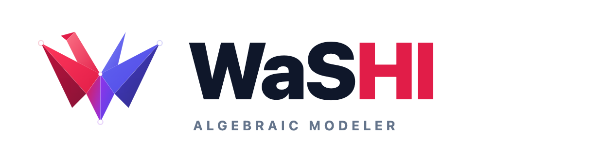

<div align="center">
  <picture>
    <source media="(prefers-color-scheme: dark)" srcset="./assets/washi-header-dark.png">
    <source media="(prefers-color-scheme: light)" srcset="./assets/washi-header-light.png">
    
  </picture>
  <p><strong>TypeScript 数理最適化モデラー</strong></p>
  <p>
    <em>線形計画 (LP) • 混合整数計画 (MIP) • 凸二次計画 (QP) • SMT論理制約 &amp; 矛盾診断</em>
  </p>
  <p>
    <a href="./README.md">English</a> •
    <a href="./README.ja.md">日本語</a> •
    <a href="./README.zh-CN.md">简体中文</a>
  </p>
  <p>
    <a href="https://www.npmjs.com/package/@ohtaman/washi"></a>
    <a href="https://github.com/ohtaman/washi/actions/workflows/distribution.yml"></a>
    <a href="https://washi.ohtaman.dev/ja/"></a>
    <a href="https://washi.ohtaman.dev/demo/"></a>
    <a href="./LICENSE"></a>
  </p>
</div>

---

**WaSHI**（WebAssembly-backed, Solver-independent, High-level modeling Interface）は、Python の **PuLP** に着想を得た、数理最適化と制約プログラミングのための TypeScript / JavaScript 向け代数モデラーです。変数・目的関数・制約をアプリケーションコードで記述し、Node.js やブラウザ上で **HiGHS**（標準）・**Z3**・**GLPK** を使ってそのまま求解できます。

## ✨ 主な特徴

- **直感的な数式記述**: `` expr`30 * ${x} + 50 * ${y} <= 40` `` や総和・内積（`sum`, `dot`）で数式と制約を簡潔に書けます。
- **Node.js・ブラウザで完結**: WebAssembly ベースのため、Python サーバーや C/C++ のネイティブビルドなしで動作します。
- **ソルバー非依存**: 標準同梱の **HiGHS** に加え、オプションの **Z3**・**GLPK** や独自ソルバーへ切り替えられます。
- **充足判定と矛盾診断**: 論理・数値制約の充足可能性判定や、実行不能（Infeasible）になった原因制約の特定に対応しています。
- **大規模問題の分解法**: 列生成法やベンダーズ分解などの分解アルゴリズムをサポートしています。

## 📚 ドキュメント & リンク

- **[ドキュメント](https://washi.ohtaman.dev/ja/)**: モデリングガイド・ソルバー仕様・環境別の導入手順
- **[ショーケース](https://washi.ohtaman.dev/ja/showcase/) & [ブラウザデモ](https://washi.ohtaman.dev/demo/)**: ブラウザ上で動くデモアプリ集とプレイグラウンド
- **[サンプル集](https://washi.ohtaman.dev/ja/examples/)**: 課題別の実践レシピと実行可能なサンプルコード（[`examples/`](examples/README.md)）
- **[AIエージェント向けガイド](docs/ja/getting-started/ai-agents.md) · [Agent Skill (`SKILL.md`)](skills/washi/SKILL.md) · [`llms.txt`](https://washi.ohtaman.dev/llms.txt) / [`llms-full.txt`](https://washi.ohtaman.dev/llms-full.txt)**: AI コーディングエージェント向けのリファレンス・スキル定義・機械可読ドキュメント

---

## 📦 インストール & クイックスタート

```bash
npm install @ohtaman/washi

# オプションのソルバープラグイン
npm install z3-solver   # SMT 論理制約・Unsat Core 診断を使う場合
npm install glpk.js     # GLPK ソルバーを使う場合 (GPL-3.0)

# AI コーディングエージェント用スキル (Claude Code, Cursor, Codex 等)
npx skills add ohtaman/washi
```

```ts
import { Model, expr, maximize } from "@ohtaman/washi";

const m = new Model("木工製品の利益最大化");
const x = m.integer("机", { lb: 0 });
const y = m.integer("椅子", { lb: 0 });

m.objective(maximize(expr`30 * ${x} + 50 * ${y}`));
m.constraint(expr`${x} + 2 * ${y} <= 40`, "木材上限");
m.constraint(expr`2 * ${x} + ${y} <= 50`, "労働力上限");

await m.solve();
console.log(`生産量: x=${x.value}, y=${y.value} (最大利益: $${m.objectiveValue})`);
```

---

## ⚙️ 対応ソルバー

| ソルバー | ライセンス | 対応クラス | 主な用途 | 導入方法 |
| :--- | :--- | :--- | :--- | :--- |
| **[HiGHS](https://github.com/ERGO-Code/HiGHS)** | MIT | LP, MIP, 凸QP | 数値最適化・エラスティック矛盾修復 | 標準搭載（設定不要） |
| **[Z3](https://github.com/Z3Prover/z3)** | MIT | SMT, SAT, 論理, MIP | 論理ルール・充足判定・厳密な `unsatCore` | `import "@ohtaman/washi/solvers/z3"` |
| **[GLPK](https://www.gnu.org/software/glpk/)** | GPL-3.0 | LP, MIP | 線形・混合整数最適化 | `import "@ohtaman/washi/solvers/glpk"` |
| **Mock** | MIT | — | テスト用の決定論的な模擬応答 | 標準搭載 (`MockSolver`) |

プラグインを import した上で、`new Model(...)`・`m.solve(...)`・`m.check(...)` に `{ solver: "z3" }` または `{ solver: "glpk" }` を渡して切り替えます。

---

## 🚀 基本的な使い方

### 1. 総和・内積（`sum` / `dot`）と条件付き制約

`dot` / `sum` による線形式の記述と、`m.indicator()` による条件付き制約：

```ts
import { Model, expr, minimize } from "@ohtaman/washi";

const m = new Model("TransportPlanning");
const factories = ["Tokyo", "Osaka"];
const stores = ["StoreA", "StoreB"];
const costs = {
  Tokyo: { StoreA: 4, StoreB: 7 },
  Osaka: { StoreA: 8, StoreB: 3 },
};

const open = m.binary(factories);
const ship = m.continuous(factories, stores, { lb: 0, ub: 500 });

// 東京工場が閉鎖 (open["Tokyo"] == 0) なら東京工場からの総輸送量は 0
m.indicator(open["Tokyo"], expr`sum(${ship["Tokyo"]}) <= 0`, { activeValue: 0 });
m.constraint(expr`${ship["Tokyo"]["StoreA"]} + ${ship["Osaka"]["StoreA"]} >= 100`, "demand_A");

m.objective(minimize(expr`dot(${costs}, ${ship})`));
await m.solve();

console.log("Tokyo -> StoreA:", ship["Tokyo"]["StoreA"].value);
```

### 2. 凸二次計画 (QP)

線形制約のもとで二次の目的関数を最小化：

```ts
import { Model, expr, minimize } from "@ohtaman/washi";

const m = new Model("PortfolioQP");
const x = m.continuous("tech", { lb: 0, ub: 1 });
const y = m.continuous("bonds", { lb: 0, ub: 1 });

m.constraint(expr`${x} + ${y} == 1`, "budget");
m.constraint(expr`0.14 * ${x} + 0.04 * ${y} >= 0.08`, "min_return");
m.objective(minimize(expr`0.04 * ${x}^2 + 0.005 * ${y}^2`));

await m.solve();
console.log(`Tech: ${x.value?.toFixed(2)}, Bonds: ${y.value?.toFixed(2)}`);
```

### 3. SMT 論理ルール & 矛盾診断 (`m.check`)

論理条件（`m.bool`, `implies`）を含むモデルの充足可能性を判定し、矛盾時の原因制約を特定します：
- **HiGHS（標準）**: 緩和すれば実行可能になる**修復集合**（`res.conflicts`）を特定します。
- **Z3**: 相互に矛盾している**充足不能コア**（`res.unsatCore` / `res.conflicts`）を抽出します。

```ts
import { Model, implies, expr } from "@ohtaman/washi";
// import "@ohtaman/washi/solvers/z3"; // 厳密な SMT unsatCore を抽出する場合

const m = new Model("StaffingRules");
const engineers = m.integer("engineers", { lb: 0, ub: 20 });
const budget = m.continuous("budget", { lb: 0, ub: 100000 });
const rush = m.bool("rush");

m.constraint(expr`8000 * ${engineers} <= ${budget}`, "budget_limit");
m.constraint(rush, "rush_required");
m.constraint(implies(rush, expr`${engineers} >= 8`), "rush_staffing");
m.constraint(expr`${budget} <= 50000`, "budget_cap"); // 矛盾: 8人 * $8,000 > $50,000
m.constraint(expr`${engineers} >= 1`, "min_staff");   // 無関係な制約

const res = await m.check(); // または await m.check({ solver: "z3" })
console.log(res.status);     // "Unsat"
console.log(res.conflicts);  // HiGHS: ["rush_required"]
```

---

## 🌐 ブラウザ & Web Worker での利用方法

- **バンドラー (Vite / webpack 5)**: `import { Model } from "@ohtaman/washi"` でそのまま動作します。ブラウザでは標準で Web Worker 上で実行されます（メインスレッドで実行する場合は `{ useWorker: false }` を指定）。
- **単体 ESM / script タグ / CDN**: `dist/browser/` 一式（`highs.wasm` や Worker を含む）を配信するか、CDN の URL を指定して読み込みます。

```html
<!-- ブラウザ ESM -->
<script type="module">
  import { Model } from "./washi/washi.js";
  // オプションプラグイン: import "./washi/solvers/glpk.js" または "./washi/solvers/z3.js"
  const m = new Model();
  await m.solve();
</script>

<!-- script タグ / CodePen (グローバル Washi を公開) -->
<script src="https://cdn.jsdelivr.net/npm/@ohtaman/washi/dist/browser/washi.min.js"></script>
```

> [!NOTE]
> **ブラウザでの Z3 利用**: Z3 の WebAssembly は `SharedArrayBuffer` を使用するため、Cross-Origin Isolation（`COOP: same-origin` / `COEP: require-corp`）が必要です。詳細は [Cross-Origin Isolation 設定](docs/ja/getting-started/cross-origin.md) および [`examples/distribution/`](examples/distribution/README.md) を参照してください。

---

## 🤝 コントリビューション・開発

ローカル開発、テスト・ベンチマークの実行、WebAssembly アセットの再ビルド、およびリリース手順については [CONTRIBUTING.md](./CONTRIBUTING.md) を参照してください。

---

## 📄 ライセンス

- **`@ohtaman/washi`**: [MIT ライセンス](./LICENSE)
- **同梱・外部ソルバー**: HiGHS (MIT)、Z3 (MIT)、GLPK (GPL-3.0)。詳細は [THIRD_PARTY_LICENSES.md](./THIRD_PARTY_LICENSES.md) を参照してください。
