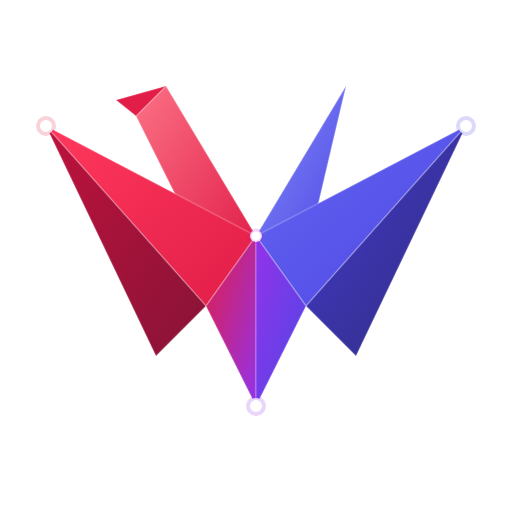

<div align="center">
  
  <h1>WaSHI (<code>@ohtaman/washi</code>)</h1>
  <p><strong>面向 TypeScript 与 JavaScript 的直观数学规划与代数建模库</strong></p>
  <p>
    <em>线性规划 (LP) • 混合整数规划 (MIP) • 凸二次规划 (QP) • SMT逻辑约束与冲突诊断</em>
  </p>
  <p>
    <a href="./README.md">English</a> •
    <a href="./README.ja.md">日本語</a> •
    <a href="./README.zh-CN.md">简体中文</a>
  </p>
  <p>
    <a href="https://www.npmjs.com/package/@ohtaman/washi"></a>
    <a href="https://bundlephobia.com/package/@ohtaman/washi"></a>
    <a href="./LICENSE"></a>
    
    
  </p>
</div>

---

**WaSHI** 是一个高层代数建模库，将 Python **PuLP** 与 Julia **JuMP** 的优雅表现力引入现代 TypeScript / JavaScript 生态系统。你可以直接使用符合数学直觉的代数公式编写数学模型，并在 Node.js、现代浏览器、Bun、Deno 及 Next.js 中秒级求解——完全依托 WebAssembly 求解器（**HiGHS**、**Z3**、**GLPK**），无需任何本地 C++ 编译环境。

```ts
import { Model, c } from "@ohtaman/washi";

const m = new Model({ sense: "Maximize" });
const x = m.addVar({ type: "Integer", lb: 0 });
const y = m.addVar({ type: "Integer", lb: 0 });

m.maximize(c`30 * ${x} + 50 * ${y}`);
m.addConstraint(c`${x} + 2 * ${y} <= 40`, "wood_limit");
m.addConstraint(c`2 * ${x} + ${y} <= 50`, "labor_limit");

await m.solve();
console.log(`生产计划: x=${x.value}, y=${y.value} (最大利润: $${m.objectiveValue})`);
```

---

## 🎯 为什么选择 WaSHI？

1. **零配置 WebAssembly 引擎**：无需预装 C/C++ 依赖，无需操作系统二进制文件，也无需手动加载 wasm。Node.js 和现代浏览器中开箱即用。
2. **极简现代代数建模 DX**：支持标签模板字面量（`c`${x} + 2 * ${y} <= 10``）与流畅的方法链（`x.mul(2).add(y).le(10)`），像在草稿纸上写公式一样自然。
3. **可插拔多求解器统一接口**：只需建模一次，即可无缝切换底层求解引擎：**HiGHS**（工业级 MIP/QP）、**Z3**（SMT 逻辑与 Unsat Core 冲突诊断）、或 **GLPK**。
4. **约束满足与冲突根因诊断**：当业务规则出现矛盾（Infeasible）时，内置 `unsatCore` 诊断可瞬时提取最小冲突约束子集。
5. **Python PuLP / python-mip 兼容层**：提供 `LpProblem`, `lpSum`, `MipModel` 等对等 API，轻松迁移 Python 最优化代码资产。
6. **工业级大规模性能**：采用 $O(N)$ 线性时间表达式构建器，可在数秒内构建并求解 20,000+ 变量的大规模 MIP 问题。

---

## ⚡ 求解器矩阵

| 求解器 | 核心许可证 | 支持的问题类型 | 最佳应用场景 | 在 WaSHI 中的提供方式 |
| :--- | :--- | :--- | :--- | :--- |
| **HiGHS** | **MIT** | **LP, MIP, 凸QP** | 工业级生产排程、运筹规划、金融组合优化 | **内置默认**（零配置） |
| **Z3** | **MIT** | **SMT, SAT, 命题逻辑, MIP** | 业务规则验证、约束冲突诊断 (`unsatCore`)、规则引擎 | 可选插件 (`@ohtaman/washi/solvers/z3`) |
| **GLPK** | **GPL-3.0** | **LP, MIP** | 学术基准测试、存量 GLPK 模型迁移 | 可选插件 (`@ohtaman/washi/solvers/glpk`) |
| **Mock** | **MIT** | *任意* | CI/CD 环境下无需加载 WASM 的极速单元测试 | 内置 |

---

## 📦 安装

```bash
# npm
npm install @ohtaman/washi

# pnpm
pnpm add @ohtaman/washi

# yarn
yarn add @ohtaman/washi

# bun
bun add @ohtaman/washi
```

*(可选)* 若需使用 Z3 或 GLPK 求解器，可按需安装对应依赖包：

```bash
npm install z3-solver    # 用于 SMT 与冲突诊断
npm install glpk.js      # 用于 GLPK 求解器 (GPL-3.0)
```

---

## 🚀 快速上手指南

### 1. 混合整数线性规划 (MIP: 生产计划问题)

在有限资源约束下实现利润最大化：

```ts
import { Model, c, expr } from "@ohtaman/washi";

const m = new Model({ name: "FactoryPlanning", sense: "Maximize" });

// 决策变量（非负整数）
const chairs = m.addVar({ name: "chairs", type: "Integer", lb: 0 });
const tables = m.addVar({ name: "tables", type: "Integer", lb: 0 });

// 借助标签模板字面量自然表达目标函数与约束
m.maximize(expr`30 * ${chairs} + 50 * ${tables}`);
m.addConstraint(c`${chairs} + 2 * ${tables} <= 40`, "wood_limit");
m.addConstraint(c`2 * ${chairs} + ${tables} <= 50`, "labor_limit");

// 使用默认的 HiGHS WASM 引擎求解
const status = await m.solve();

console.log(`求解状态: ${status}`); // "Optimal"
console.log(`最大利润: $${m.objectiveValue}`); // 1100
console.log(`生产量: 椅子=${chairs.value}, 桌子=${tables.value}`); // 椅子 20, 桌子 10
```

#### 🗂 多维变量网格 (`addVars`)

一行代码声明变量字典或多维变量矩阵（类似于 PuLP 的 `LpVariable.dicts`）：

```ts
// 1D 字典形式的布尔变量
const openCity = m.addVars(["Tokyo", "Osaka", "Nagoya"], { type: "Binary" });

// 2D 运输量矩阵: [工厂] x [门店]
const flow = m.addVars(["F1", "F2"], ["StoreA", "StoreB"], { lb: 0 });

// 2D 网格坐标 (例如 8x8 棋盘)
const board = m.addVars(8, 8, { type: "Binary", prefix: "queen" });
```

#### 🔀 Big-M 指示约束 (`addIndicator`)

直接表达条件激活与固定成本逻辑，无需手动进行繁琐的 Big-M 代数推导：

```ts
// "若工厂关闭 (openCity['Tokyo'] == 0)，则产量 flow 必须为 0"
m.addIndicator(openCity.get("Tokyo")!, flow.get("F1", "StoreA")!.le(0), {
  activeValue: 0,
  M: 1000,
});
```

---

### 2. 投资组合风险最小化 (凸二次规划: QP)

在满足预期收益与预算约束的前提下，基于协方差矩阵最小化投资组合风险：

```ts
import { Model, QuadExpr, sum } from "@ohtaman/washi";

const m = new Model({ name: "MarkowitzPortfolio", sense: "Minimize" });
const assets = ["Tech", "Bonds", "RealEstate"];
const returns = [0.14, 0.04, 0.08];

// 决策变量: 各资产投资权重 (0.0 ~ 1.0)
const w = assets.map((a) => m.addVar({ name: `w_${a}`, lb: 0, ub: 1 }));

// 1. 预算约束: 资金分配总额 100%
m.addConstraint(sum(w).eq(1.0), "budget");

// 2. 目标回报率: 组合最低回报率 >= 8.5%
m.addConstraint(sum(w.map((v, i) => v.mul(returns[i]))).ge(0.085), "min_return");

// 3. 资产协方差矩阵 (风险与相关性)
const cov = [
  [0.040, 0.002, 0.015],
  [0.002, 0.005, 0.002],
  [0.015, 0.002, 0.025],
];

// 二次目标函数: w^T * Cov * w
let risk = new QuadExpr();
for (let i = 0; i < assets.length; i++) {
  for (let j = 0; j < assets.length; j++) {
    risk = risk.add(w[i].mul(w[j]).mul(cov[i][j]));
  }
}
m.minimize(risk);

await m.solve();
console.log(`最小方差: ${m.objectiveValue?.toFixed(6)}`);
assets.forEach((name, i) => {
  console.log(`  ${name}: ${((w[i].value || 0) * 100).toFixed(2)}%`);
});
```

---

### 3. SMT 逻辑与规则引擎 (集成 Z3)

原生支持布尔命题变量（`BoolVar`）、逻辑连接词（`and`, `or`, `implies`, `not`, `xor`）与数值算术约束的混合表达：

```ts
import { Model, not } from "@ohtaman/washi";

const m = new Model({ name: "SmartSecurityRules" });

const isNight = m.addBoolVar("isNight");
const motion = m.addBoolVar("motion");
const alarm = m.addBoolVar("alarm");
const siren = m.addBoolVar("siren");
const lux = m.addVar({ name: "lux", type: "Integer", lb: 0 });

// 规则定义
m.addConstraint(lux.le(50).implies(isNight), "dark_implies_night");
m.addConstraint(motion.and(isNight).and(alarm).implies(siren), "alarm_rule");

// 传感器当前输入数据
m.addConstraint(lux.le(10), "sensor_dark");
m.addConstraint(motion, "sensor_motion");
m.addConstraint(alarm, "alarm_on");

// 无目标函数直接判定可满足性 (SAT)
const res = await m.check({ solver: "z3" });

console.log(`系统状态满足？ ${res.status === "Sat"}`); // true
console.log(`警报响起？ ${m.values.get("siren")}`); // true
```

---

### 4. 约束冲突根因诊断 (`unsatCore`)

当规则或约束之间存在矛盾时，Z3 能够精准指出引发冲突的**最小冲突约束子集**：

```ts
import { Model } from "@ohtaman/washi";

const m = new Model({ name: "BudgetConflict" });
const engineers = m.addVar({ name: "engineers", type: "Integer", lb: 0 });
const budget = m.addVar({ name: "budget", lb: 0 });
const rush = m.addBoolVar("rush");

m.addConstraint(engineers.mul(8000).le(budget), "cost_limit");
m.addConstraint(rush, "rush_required");
m.addConstraint(rush.implies(engineers.ge(8)), "rush_staffing");
m.addConstraint(budget.le(50000), "budget_cap"); // 冲突点: 8人 * $8,000 = $64,000 > 预算上限 $50,000!
m.addConstraint(engineers.ge(1), "unrelated_rule"); // 无关规则

const res = await m.check({ solver: "z3" });

console.log(`求解状态: ${res.status}`); // "Unsat"
console.log("冲突约束子集:", res.unsatCore);
// 输出: ["cost_limit", "rush_required", "rush_staffing", "budget_cap"]
// 注：无关的 "unrelated_rule" 被准确排除在外！
```

---

### 5. Python PuLP 兼容层

若你已有 Python PuLP 代码资产，可零摩擦迁移：

```ts
import {
  LpProblem,
  LpVariable,
  LpMaximize,
  LpInteger,
  HiGHS,
  value,
} from "@ohtaman/washi";

const prob = new LpProblem("PuLPDemo", LpMaximize);

const x = new LpVariable("x", 0, undefined, LpInteger);
const y = new LpVariable("y", 0, undefined, LpInteger);

// 等同于 PuLP 中的 += 语法
prob.add(x.mul(30).add(y.mul(50)));
prob.add(x.add(y.mul(2)).le(40));
prob.add(x.mul(2).add(y).le(50));

await prob.solve(new HiGHS());

console.log(`状态: ${prob.status}`);
console.log(`目标函数值: ${value(prob.objective)}`);
console.log(`x = ${value(x)}, y = ${value(y)}`);
```

---

## 💻 本地脚本与交互式 Web 演示

在 `examples/node/` 中提供了即开即用的独立脚本：

```bash
npx tsx examples/node/01-production-planning.ts
npx tsx examples/node/02-knapsack-problem.ts
npx tsx examples/node/03-portfolio-qp.ts
npx tsx examples/node/04-smt-security-rules.ts
npx tsx examples/node/05-unsat-core-diagnosis.ts
npx tsx examples/node/06-pulp-compatibility.ts
```

启动浏览器端交互式可视化演示 (`examples/web-demo`)：

```bash
npm run dev
# 在浏览器中访问 http://localhost:5173/
```

---

## 🧪 自动化测试

项目全面贯彻测试驱动开发 (TDD)，涵盖 120+ 单元测试、集成测试与大规模基准测试：

```bash
# 运行全部单元与集成测试
npm test

# 构建生产级依赖包与 TypeScript 类型定义
npm run build
```

---

## 💡 关于项目名称 (About the Name)

Python 著名的运筹优化库 **PuLP** 将线性规划首字母缩写巧妙地关联为英文词汇 *pulp*（纸张原料“纸浆”）。

**WaSHI (和紙)** 则代表其升华后的传统艺术瑰宝——日本传统和纸：**极薄极轻（核心仅 ~7 kB）、柔韧多变、且历经千年而不腐**。

反向首字母缩写：**Wa** (WebAssembly / 和) • **S**ystem for **H**ybrid & **I**nteger modeling (**WaSHI**)。

---

## 📄 许可证与开源合规

- **`@ohtaman/washi` 核心代码**：**MIT 许可证**（商业与个人均可自由使用）。
- **HiGHS 默认求解引擎**：**MIT 许可证**（WebAssembly 编译内置，无传染风险）。
- **Z3 引擎（可选）**：**MIT 许可证**。
- **GLPK 插件（可选）**：**GPL-3.0 许可证**（完全隔离在独立子包中，确保 WaSHI 核心纯粹的 MIT 合规性）。
