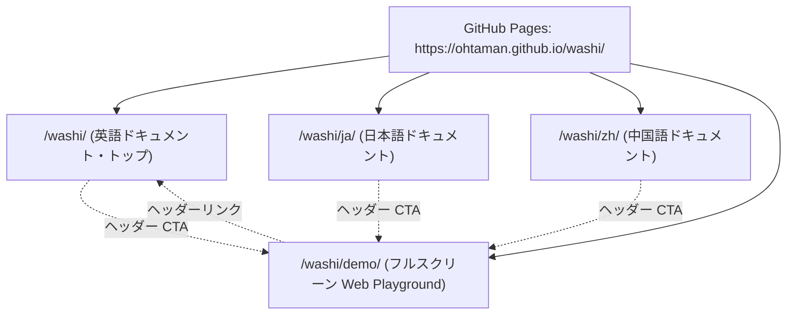

# WaSHI ドキュメント拡充 計画書 (Documentation Expansion Plan)

## 1. 概要と目的

WaSHI（`@ohtaman/washi`）の利用者がスムーズに導入・モデリング・本番運用を行えるよう、包括的かつ多言語対応の公式ドキュメントサイトを構築する。

- **言語優先順位**:
  1. **英語 (`en`)** [最優先 / マスターコンテンツ]
  2. **日本語 (`ja`)**
  3. **簡体字中国語 (`zh-CN`)**
- **ホスティング先**: `https://ohtaman.github.io/washi/`（GitHub Pages）
- **構成方針**: 静的ドキュメントサイト（VitePress）を導入し、既存の Web Playground（`dist/demo`）とシームレスに相互リンク・統合。

---

## 2. GitHub Pages (`ohtaman.github.io/washi`) へのホスティング妥当性評価

| 評価項目 | 評価 | 理由・メリット |
| :--- | :---: | :--- |
| **製品特性との親和性** | **◎** | WaSHI の最大の特徴は「ブラウザ/WebAssembly で完結する最適化」。ドキュメントと Web Playground を同一オリジンに配置することで、読んだコードを即座にブラウザ上で動かせる。 |
| **運用・インフラコスト** | **◎** | 既に `.github/workflows/deploy-demo.yml` で GitHub Pages への自動デプロイが整備されており、追加コスト・管理工数がゼロ。 |
| **多言語ルーティング & SEO** | **◎** | ルート `/washi/` (英語), `/washi/ja/`, `/washi/zh/` の URL 設計が可能で、海外・国内・中華圏の検索エンジンからの流入を最大化。 |
| **デモとの統合** | **◎** | `/washi/`（ドキュメント）と `/washi/demo/`（フルスクリーン・インタラクティブデモ）を 1 つのビルド成果物として GitHub Pages にまとめて配置可能。 |

**結論**: GitHub Pages を公式ドキュメントおよびデモの統合ホスティング先とすることが最も合理的で開発・運用効率が高い。

---

## 3. ドキュメントツール・技術選定

### 推奨: **VitePress**
- **選定理由**:
  1. **高速な Vite エコシステム**: リポジトリ既存のビルドチェーン（Vite）と完全に統一。
  2. **組み込み i18n サポート**: 言語切り替えバー、フォールバック、`/`, `/ja/`, `/zh/` ルーティングが標準提供。
  3. **Vue / TS コンポーネント埋め込み**: 将来的に Markdown 内に「WaSHI ソルバー実行コンポーネント」を埋め込み、ドキュメント上で直接計算を実行可能。
  4. **標準機能の充実**: コードブロックの言語切替・行ハイライト・コピーボタン、目次自動追従、ローカル全文検索。

---

## 4. `docs/` ディレクトリ設計 & コンテンツ構成

英語 (`en`) をマスター（ルート）とし、各言語で対称なディレクトリ構造を持たせる。

```text
docs/
├── .vitepress/                  # VitePress 設定・テーマ・ナビゲーション
│   ├── config.mts               # i18n, ナビバー, サイドバー, 検索等の設定
│   └── theme/                   # カスタムスタイル
├── public/                      # ロゴ、図版、WASM/アセット
│
│   # ===== 英語 (en: ルート / 最優先) =====
├── index.md                     # [en] トップページ (ヒーロー, 特徴, クイックコード)
├── getting-started/
│   ├── index.md                 # インストールと初めてのモデル作成
│   ├── runtimes.md              # Node.js, ブラウザ, Next.js/SSR, Bun, Deno
│   └── cross-origin.md          # Z3 / SharedArrayBuffer / COOP・COEP / ワークアラウンド
├── guide/
│   ├── variables.md             # 変数 (Continuous, Integer, Binary, 半連続の定式化)
│   ├── expressions.md           # 数式 (LinExpr, QuadExpr, expr`...`, sum, dot)
│   ├── constraints.md           # 等式・不等式制約、c`...` 構文
│   ├── objectives.md            # maximize / minimize, LP, MIP, QP
│   ├── pulp-compat.md           # Python PuLP / python-mip からの移行ガイド
│   └── unsat-core.md            # 実行不可能 (Infeasible) モデルの制約競合診断
├── solvers/
│   ├── highs.md                 # HiGHS: デフォルト, LP/MIP/QP, Worker 設定
│   ├── z3.md                    # Z3: SMT, 論理制約, Unsat Core 診断
│   ├── glpk.md                  # GLPK: GPL-3.0, レガシー互換, 動的ロード
│   └── custom-solver.md         # 独自のカスタムソルバー開発ガイド
├── examples/
│   ├── production.md            # 生産計画問題 (LP) [examples/node/01]
│   ├── knapsack.md              # ナップサック問題 (MIP) [examples/node/02]
│   ├── portfolio-qp.md          # ポートフォリオ最適化 (QP) [examples/node/03]
│   ├── smt-security.md          # セキュリティポリシールール検証 (SMT) [examples/node/04]
│   └── nurse-scheduling.md      # ナーススケジューリング / シフト最適化
├── api/
│   └── index.md                 # 主要クラス・インターフェースのリファレンス
│
│   # ===== 日本語 (ja) =====
├── ja/
│   ├── index.md                 # [ja] トップページ
│   ├── getting-started/         # [ja] 入門・環境構築
│   ├── guide/                   # [ja] モデリングガイド
│   ├── solvers/                 # [ja] ソルバー
│   └── examples/                # [ja] 実践例
│
│   # ===== 簡体字中国語 (zh-CN) =====
└── zh/
    ├── index.md                 # [zh] 首页
    ├── getting-started/         # [zh] 快速入门
    ├── guide/                   # [zh] 建模指南
    ├── solvers/                 # [zh] 求解器
    └── examples/                # [zh] 实际案例
```

---

## 5. サイト全体のデプロイ・ルーティング設計

GitHub Pages のベース URL を `/washi/` とし、以下のように配置する。



### ビルド & CI パイプライン統合案
1. `npm run docs:build` で `docs/.vitepress/dist` にドキュメントをビルド
2. `npm run build:demo` で `dist/demo` に Web Playground をビルド
3. CI (`.github/workflows/deploy-demo.yml`) にて：
   - ドキュメント生成物をデプロイルートへコピー
   - Web Playground をその配下の `/demo/` サブディレクトリへコピー
   - まとめて GitHub Pages にデプロイ

---

## 6. 段階的実装ロードマップ

- **Phase 1: ドキュメント基盤の確立**
  - VitePress のインストール、共通ナビゲーション・サイドバー・テーマ設定
  - `package.json` に `docs:dev`, `docs:build` スクリプトを追加
  - GitHub Actions で Docs と Demo をまとめて GitHub Pages へ公開するパイプライン整備
- **Phase 2: 英語 (`en`) コンテンツの執筆（最優先）**
  - README.md の各セクションを独立したトピック記事へ展開・深掘り
  - `docs/custom-solver-guide.md` の統合
  - `examples/node/*.ts` (01〜08) の解説付きレシピ化
- **Phase 3: 日本語 (`ja`) コンテンツの展開**
  - `README.ja.md` の既存テキストを活用しつつ、en の最新版に合わせて翻訳・ローカライズ
- **Phase 4: 簡体字中国語 (`zh-CN`) コンテンツの展開**
  - `README.zh-CN.md` の既存テキストを活用し、翻訳・展開
- **Phase 5: 仕上げと高度化**
  - TypeDoc による TypeScript 型定義ベースの API リファレンス整備
  - Markdown 内へのインタラクティブな WaSHI 計算コンポーネント配置
