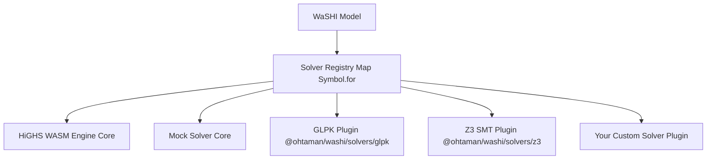

# WaSHI カスタムソルバー開発ガイド

このガイドでは、**WaSHI**（`@ohtaman/washi`）向けに独自のソルバープラグインを実装・テスト・配布する方法を説明します。

WaSHI は疎結合なソルバープラグインアーキテクチャを採用しています。コアの `@ohtaman/washi` にはゼロコンフィグの HiGHS WASM エンジンと `MockSolver` のみが含まれており、独自の WebAssembly エンジン、ネイティブ C++ アドオン、Web Worker、あるいは社内クラウドの REST / RPC ソルバーバックエンドを統一された `Model` API 経由で統合できます。

---

## 1. プラグインアーキテクチャの概要



### アーキテクチャの特徴
1. **統一されたグローバルレジストリ**: ソルバーレジストリは `globalThis` 上の `Symbol.for("washi.solverRegistry")` で管理されます。異なる ESM チャンク、動的インポート、または `<script>` タグ間でも同一のソルバーマップを参照できます。
2. **環境に依存しない一貫性**: Node.js とブラウザで同一のインターフェース、ソルバー名解決、能力判定（`SolverCapabilities`）、およびエラーメッセージを提供します。
3. **疎結合バンドル**: コアパッケージはオプションプラグインやカスタムプラグインをインポートしないため、プラグインが明示的にインポートされたときのみ自身を登録します。

---

## 2. API コントラクトと TypeScript 型定義

すべてのカスタムソルバーは、`@ohtaman/washi` で定義されている `Solver` インターフェースを実装する必要があります：

```typescript
import {
  generateLpString,
  buildLpSymbolMaps,
  isLpExportResult,
  sanitizeIdentifier,
  type Solver,
  type SolverOptions,
  type SolverResult,
  type SolverCheckResult,
  type SolverCapabilities,
  type SolveModelData,
  type CheckModelData,
  type LogicalConstraintItem,
  type LpModelData,
  type LpExportResult,
  type LpSymbolMaps,
  type SolverStatus,
  type TerminationStatus,
  type SolveProgressEvent,
} from "@ohtaman/washi";
```

### `Solver` インターフェース

```typescript
export interface Solver {
  /** ソルバーの一意な表示名 (例: "GLPK", "AcmeCloudSolver") */
  readonly name: string;

  /** ソルバーのバージョン文字列 (例: "1.2.0") */
  readonly version?: string;

  /** 対応している問題クラスを宣言する能力フラグ */
  readonly capabilities?: SolverCapabilities;

  /**
   * LP, MIP, QP, SMT 最適化モデルの主求解メソッド。
   *
   * @param modelData メモリ上の型付きモデル構造 (variables, constraints, objective, sense, boolVars, logicalConstraints)
   * @param options 実行時オプション (timeLimit, mipGap, verbose, signal, onProgress 等)
   */
  solve(
    modelData: SolveModelData,
    options?: SolverOptions
  ): Promise<SolverResult>;

  /**
   * 目的関数なしの純粋な SAT / SMT または実行可能性判定用の任意メソッド。
   *
   * @param modelData 目的関数なしのメモリ上モデル構造 (variables, boolVars, constraints, logicalConstraints)
   * @param options 実行時オプション
   */
  check?(
    modelData: CheckModelData,
    options?: SolverOptions
  ): Promise<SolverCheckResult>;
}
```

### `CheckModelData` & `SolveModelData`

`Model.solve()` および `Model.check()` は、事前に LP 文字列を直列化することなく、構造化されたモデルデータを直接アダプターへ渡します：

```typescript
export interface CheckModelData {
  /** モデル名 */
  name?: string;
  /** モデルに登録された決定変数 */
  variables: Var[];
  /** モデルに登録された命題論理変数 */
  boolVars?: BoolVar[];
  /** モデルに登録された線形算術制約 */
  constraints: Constraint[];
  /** モデルに登録された論理 / SMT 制約 */
  logicalConstraints?: LogicalConstraintItem[];
}

export interface SolveModelData extends CheckModelData {
  /** 最適化方向 ("Minimize" | "Maximize") */
  sense: OptimizationSense;
  /** 線形または2次の目的関数式 */
  objective: LinExpr | QuadExpr;
}
```

### `SolverCapabilities`

カスタムソルバーは対応機能を `capabilities` で宣言します。`Model` は `solve()` または `check()` をディスパッチする前に以下の条件を検証します：
- 目的関数に2次項（`QuadExpr`）が含まれる場合：`supportsQP === false` でないか
- モデルに論理制約（`m.logicalConstraints`）が含まれる場合：`supportsSMT !== true` でないか
- いずれかの変数に初期値ヒント（`initialValue`）が設定されている場合：`supportsWarmStart !== true` でないか

```typescript
export interface SolverCapabilities {
  /** 混合整数計画法（整数・バイナリ変数）のサポート */
  supportsMIP?: boolean;

  /** 2次目的関数（QP: x^T Q x + c^T x）のサポート */
  supportsQP?: boolean;

  /** 2次錐制約または2次制約（QCQP）のサポート */
  supportsQCQP?: boolean;

  /** SMT / 命題論理制約のサポート */
  supportsSMT?: boolean;

  /** Unsat Core（矛盾する制約の部分集合）抽出のサポート */
  supportsUnsatCore?: boolean;

  /** 主問題初期値ヒント / MIP ウォームスタート（Var.initialValue）のサポート */
  supportsWarmStart?: boolean;
}
```

### `SolverOptions` & `SolveProgressEvent`

`solve` および `check` に渡される実行時オプションには、キャンセル用シグナルや進捗コールバックが含まれます（なお、`SolveOptions` のルーティング用 `solver` フィールドはアダプターに渡される前に取り除かれます）：

```typescript
export interface SolverOptions {
  /** 制限時間（秒） */
  timeLimit?: number;

  /** 相対 MIP ギャップ許容値 */
  mipGap?: number;

  /** ソルバーのコンソールログ出力を有効化 */
  verbose?: boolean;

  /** 協調的キャンセル用シグナル。中断時は terminationStatus: "Interrupted" を返す */
  signal?: AbortSignal;

  /** 正規化された SolveProgressEvent スナップショットを受け取る進捗コールバック */
  onProgress?: (progress: SolveProgressEvent) => void;

  /** その他のソルバー固有オプション */
  [key: string]: any;
}
```

### LP 文字列変換・シンボルマップのヘルパー関数

`GLPKSolver` や `Z3Solver` のように構造化された JS/WASM データを直接処理するソルバーでは、`SolveModelData` / `CheckModelData` をそのまま利用します。
一方、CPLEX / HiGHS 形式の LP テキストや制限された識別子構文を必要とするバックエンド向けに、WaSHI は必要に応じて利用できるヘルパー関数をエクスポートしています：

- `generateLpString(modelData): LpExportResult` — `modelData` を CPLEX LP 形式文字列（`lpString`）に変換し、衝突安全な識別子逆引きマップ（`nameToVar`, `nameToConstraint`）を返します。
- `buildLpSymbolMaps(modelData): LpSymbolMaps` — LP 文字列を生成せずに、衝突安全なサニタイズ済み識別子マップ（`nameToVar`, `varToName`, `nameToConstraint`, `constraintToName`）を構築します。
- `isLpExportResult(value): value is LpExportResult` — `LpExportResult` の実行時型ガード（旧来の3引数オーバーロード `solve(modelData, lpResult, options)` をサポートする場合に有用です）。
- `sanitizeIdentifier(raw, fallbackPrefix = "x", id = 0)` — 任意の表示名を LP 形式で有効な識別子にサニタイズします。

```typescript
export interface LpExportResult {
  /** 標準的な CPLEX/HiGHS LP 形式文字列 */
  lpString: string;

  /** サニタイズされた LP 変数識別子を WaSHI の Var オブジェクトへ逆引きするマップ */
  nameToVar: Map<string, Var>;

  /** サニタイズされた LP 制約識別子を WaSHI の Constraint オブジェクトへ逆引きするマップ */
  nameToConstraint: Map<string, Constraint>;
}
```

### `SolverResult` の正規化と識別子の復元

`solve` メソッドは、モデルの元の変数名・制約名（`v.name`, `bv.name`, `c.name`）をキーとする正規化された結果を返す必要があります。LP バックエンド向けに `generateLpString(modelData)` や `buildLpSymbolMaps(modelData)` を使用するアダプターは、`nameToVar` および `nameToConstraint` を用いてサニタイズ済み LP 識別子をモデルの元の名前に復元してください：

```typescript
export interface SolverResult {
  /** 標準化されたステータス文字列 */
  status: SolverStatus;

  /** 実行可能解の有無に依存しない正確な終了理由（省略時は status と同じ） */
  terminationStatus?: TerminationStatus;

  /** 実行可能な主問題解 / 暫定解が存在するかどうか（省略時は status と values から自動推論） */
  hasPrimalSolution?: boolean;

  /** 最適値または最良の目的関数値（実行可能解がない場合は null） */
  objectiveValue: number | null;

  /** ソルバーが提供する最良の双対境界 / 目的関数境界値 */
  objectiveBound?: number;

  /** ソルバーが提供する相対 MIP ギャップ */
  relGap?: number;

  /** relGap の別名：ソルバーが提供する相対 MIP ギャップ */
  mipGap?: number;

  /** 絶対 MIP ギャップ |objectiveValue - objectiveBound|（両方が有限値のとき自動計算） */
  absGap?: number;

  /** 元の変数名をキーとする主問題解のマップ（非有限値は無視されます） */
  values: Record<string, number>;

  /** BoolVar 名をキーとする命題論理変数の割当マップ（任意、SMT/SAT 用） */
  boolValues?: Record<string, boolean>;

  /** 変数の被約費用（任意、LP のみ） */
  reducedCosts?: Record<string, number>;

  /** 制約の双対変数 / 潜在価格（任意、LP のみ） */
  duals?: Record<string, number>;

  /** 制約のスラック値 / 余剰量（任意） */
  slacks?: Record<string, number>;

  /** 求解の実行時間（秒） */
  runTime?: number;

  /** ソルバーの診断ログ / テキスト出力 */
  logs?: string[];

  /** 検査用の生ソルバー応答オブジェクト */
  raw?: any;
}
```

#### 標準化された `SolverStatus` の値
- `"Optimal"`: 大域的最適解が見つかりました（MIP では許容誤差内、LP では最適性証明済み）。
- `"Feasible"`: 実行可能解が見つかりましたが、大域的最適性は未証明です（例：暫定解がある状態で制限時間に到達）。
- `"Infeasible"`: モデルが数学的に実行不可能であることが証明されました。
- `"Unbounded"`: モデルの目的関数が非有界です。
- `"TimeLimit"`: 最適性の証明前に `timeLimit` により終了しました。
- `"IterationLimit"`: 反復回数上限により終了しました。
- `"Sat"` / `"Unsat"`: `check()` または SMT ソルバーが返す充足可能 / 充足不能ステータス。
- `"Error"` / `"NotSolved"` / `"Unknown"`: エラー、未求解、または判別不能なステータス。**`Unknown` や `Error` を決して `Optimal` に変換しないでください。**

---

## 3. ステップバイステップ実装チュートリアル

### チュートリアル A: 社内クラウド REST ソルバーアダプター

以下は、`generateLpString(modelData)` でオンデマンドに LP 形式文字列を生成し、HTTP マイクロサービスへ送信して求解する本番対応のカスタムソルバー実装例です：

```typescript
import {
  generateLpString,
  registerSolver,
  type Solver,
  type SolverOptions,
  type SolverResult,
  type SolverStatus,
  type SolveModelData,
} from "@ohtaman/washi";

export interface CloudSolverConfig extends SolverOptions {
  endpoint?: string;
  apiKey?: string;
}

export class CloudSolver implements Solver {
  public readonly name = "CloudSolver";
  public readonly version = "1.0.0";
  public readonly capabilities = {
    supportsMIP: true,
    supportsQP: false,
  };

  private endpoint: string;
  private apiKey: string;

  constructor(config: CloudSolverConfig = {}) {
    this.endpoint = config.endpoint || "https://solver.mycompany.internal/v1/solve";
    this.apiKey = config.apiKey || "";
  }

  async solve(
    modelData: SolveModelData,
    options: SolverOptions = {}
  ): Promise<SolverResult> {
    const startTime = performance.now();
    const { lpString, nameToVar, nameToConstraint } = generateLpString(modelData);

    let payload: any;
    try {
      const response = await fetch(this.endpoint, {
        method: "POST",
        headers: {
          "Content-Type": "application/json",
          ...(this.apiKey ? { Authorization: `Bearer ${this.apiKey}` } : {}),
        },
        body: JSON.stringify({
          lp: lpString,
          timeLimit: options.timeLimit,
          mipGap: options.mipGap,
        }),
        signal: options.signal,
      });

      if (!response.ok) {
        throw new Error(`[CloudSolver] Server returned HTTP ${response.status}: ${await response.text()}`);
      }

      payload = await response.json();
    } catch (err: any) {
      if (options.signal?.aborted || err?.name === "AbortError") {
        return {
          status: "Unknown",
          terminationStatus: "Interrupted",
          objectiveValue: null,
          values: {},
          runTime: (performance.now() - startTime) / 1000,
        };
      }
      throw err;
    }

    const runTime = (performance.now() - startTime) / 1000;

    const values: Record<string, number> = Object.create(null);
    for (const [k, val] of Object.entries((payload.values || {}) as Record<string, number>)) {
      values[nameToVar.get(k)?.name ?? k] = val;
    }
    const duals: Record<string, number> = Object.create(null);
    for (const [k, val] of Object.entries((payload.duals || {}) as Record<string, number>)) {
      duals[nameToConstraint.get(k)?.name ?? k] = val;
    }
    const slacks: Record<string, number> = Object.create(null);
    for (const [k, val] of Object.entries((payload.slacks || {}) as Record<string, number>)) {
      slacks[nameToConstraint.get(k)?.name ?? k] = val;
    }

    const statusMap: Record<string, SolverStatus> = {
      OPTIMAL: "Optimal",
      FEASIBLE: "Feasible",
      INFEASIBLE: "Infeasible",
      UNBOUNDED: "Unbounded",
      TIME_LIMIT: "TimeLimit",
      TIMELIMIT: "TimeLimit",
      ITERATION_LIMIT: "IterationLimit",
      ERROR: "Error",
      NOT_SOLVED: "NotSolved",
      SAT: "Sat",
      UNSAT: "Unsat",
    };
    const status: SolverStatus = statusMap[String(payload.status).toUpperCase()] ?? "Unknown";

    return {
      status,
      objectiveValue: payload.objectiveValue ?? null,
      values,
      duals,
      slacks,
      runTime: payload.solveDuration || runTime,
      logs: payload.logs || [],
      raw: payload,
    };
  }
}

// `import "my-cloud-solver"` で `solver: "cloud"` が使えるように自動登録
export function registerCloudSolver(): void {
  registerSolver("cloud", (opts) => new CloudSolver(opts));
}
registerCloudSolver();
```

---

### チュートリアル B: カスタムソルバーの登録と利用方法

実装したカスタムソルバーは、以下の 3 つの方法で選択・利用できます：

#### 方法 1: 登録名文字列で指定する
```typescript
import { Model } from "@ohtaman/washi";
import "./cloud-solver.js"; // "cloud" を自動登録

const model = new Model({ name: "SupplyChain", solver: "cloud" });
// または model.solve("cloud")
```

#### 方法 2: ソルバーインスタンスを直接渡す
```typescript
import { Model } from "@ohtaman/washi";
import { CloudSolver } from "./cloud-solver.js";

const customInstance = new CloudSolver({
  endpoint: "https://dedicated-gpu-cluster.internal/solve",
  apiKey: "secret-token",
});

const model = new Model({ name: "FacilityLocation", solver: customInstance });
const status = await model.solve();
```

#### 方法 3: グローバルなデフォルトソルバーとして設定する
```typescript
import { setDefaultSolver, Model } from "@ohtaman/washi";
import { CloudSolver } from "./cloud-solver.js";

setDefaultSolver(() => new CloudSolver());

// 以降に作成されるすべてのモデルはデフォルトで CloudSolver を使用します
const model = new Model("DefaultedModel");
```

---

## 4. 配布: 独立したプラグインパッケージとして公開する

カスタムソルバーを独立した npm パッケージ（例：`@my-org/washi-solver-cplex`）として公開する場合の構成です：

### 1. `package.json` の `exports` 構成
```json
{
  "name": "@my-org/washi-solver-cplex",
  "version": "1.0.0",
  "type": "module",
  "main": "./dist/lib/index.js",
  "types": "./dist/types/index.d.ts",
  "exports": {
    ".": {
      "types": "./dist/types/index.d.ts",
      "import": "./dist/lib/index.js",
      "default": "./dist/lib/index.js"
    },
    "./browser": {
      "types": "./dist/types/index.d.ts",
      "import": "./dist/browser/index.js",
      "default": "./dist/browser/index.js"
    },
    "./browser/index.min.js": "./dist/browser/index.min.js"
  },
  "peerDependencies": {
    "@ohtaman/washi": ">=0.1.0"
  }
}
```

### 2. ブラウザ向け IIFE ビルド
ブラウザ用の単体スクリプト（`.min.js`）をビルドする際は、バンドラー（Vite または Rollup）を以下のように設定します：
- 出力フォーマット: `iife`
- グローバル変数名: `WashiCplex`
- `Symbol.for("washi.solverRegistry")` を介して、`<script src="washi.min.js"></script><script src="washi-cplex.min.js"></script>` を読み込むだけで自動的にレジストリが連携されます。

---

## 5. カスタムソルバーのテスト

バンドルを行わずに Vitest や Jest で直接カスタムソルバーをテストできます：

```typescript
import { describe, it, expect } from "vitest";
import { Model, expr, maximize, registerSolver, listAvailableSolvers } from "@ohtaman/washi";
import { CloudSolver } from "./cloud-solver.js";

describe("Custom Solver Integration", () => {
  it("registers in available solvers list", () => {
    registerSolver("cloud-test", () => new CloudSolver());
    expect(listAvailableSolvers()).toContain("cloud-test");
  });

  it("propagates primal values and duals into WaSHI Model", async () => {
    const model = new Model({ solver: new CloudSolver() });
    const x = model.continuous("x", { lb: 0, ub: 10 });
    const y = model.continuous("y", { lb: 0, ub: 10 });
    model.objective(maximize(expr`2 * ${x} + 3 * ${y}`));
    model.constraint(expr`${x} + ${y} <= 12`, "budget");

    const status = await model.solve();
    expect(status).toBe("Optimal");
    expect(x.value).toBeDefined();
    const c1 = model.getConstraintByName("budget");
    expect(c1?.dual).toBeDefined();
  });
});
```
