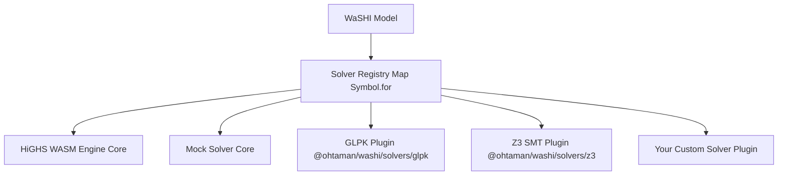

# カスタムソルバー開発ガイド

このガイドでは、**WaSHI**（`@ohtaman/washi`）向けに独自のソルバープラグインを実装・テスト・配布する方法を説明します。

WaSHI は疎結合なソルバープラグインアーキテクチャを採用しています。コアの `@ohtaman/washi` にはゼロコンフィグの HiGHS WASM エンジンと `MockSolver` のみが含まれており、独自の WebAssembly エンジン、Web Worker、あるいは社内クラウドの REST / gRPC ソルバーバックエンドを `Solver` インターフェース経由で統合できます。

---

## 1. プラグインアーキテクチャの概要



### アーキテクチャの特徴
1. **グローバル共有レジストリ**: ソルバーレジストリは `globalThis` 上の `Symbol.for("washi.solverRegistry")` で管理されます。異なる ESM チャンクや `<script>` タグ間でも同一のソルバーマップを参照できます。
2. **環境に依存しない一貫性**: Node.js とブラウザで同一のインターフェース・能力判定（`SolverCapabilities`）・エラー処理を提供します。
3. **疎結合バンドル**: コアパッケージはオプションプラグインを静的インポートしないため、必要なプラグインだけをインポートしてバンドルサイズを最小に保てます。

---

## 2. API コントラクトと TypeScript 型定義

すべてのカスタムソルバーは `@ohtaman/washi` の `Solver` インターフェースを実装します：

```typescript
import {
  generateLpString,
  buildLpSymbolMaps,
  isLpExportResult,
  sanitizeIdentifier,
  type Solver,
  type SolverOptions,
  type SolverResult,
  type SolverCheckResult,
  type SolverCapabilities,
  type SolveModelData,
  type CheckModelData,
  type LogicalConstraintItem,
  type LpModelData,
  type LpExportResult,
  type LpSymbolMaps,
  type SolverStatus,
  type TerminationStatus,
  type SolveProgressEvent,
} from "@ohtaman/washi";
```

### `Solver` インターフェース

```typescript
export interface Solver {
  /** ソルバーの一意な表示名 (例: "GLPK", "AcmeCloudSolver") */
  readonly name: string;

  /** ソルバーのバージョン文字列 (例: "1.2.0") */
  readonly version?: string;

  /** 対応している問題クラスを示すフラグ */
  readonly capabilities?: SolverCapabilities;

  /**
   * LP, MIP, QP, SMT 最適化モデルの求解メソッド
   */
  solve(
    modelData: SolveModelData,
    options?: SolverOptions
  ): Promise<SolverResult>;

  /**
   * 目的関数なしの充足可能性判定 (SAT / SMT / 実行可能性チェック) メソッド (任意)
   */
  check?(
    modelData: CheckModelData,
    options?: SolverOptions
  ): Promise<SolverCheckResult>;
}
```

### `SolverCapabilities`

カスタムソルバーがサポートする機能を `capabilities` で宣言すると、`Model` は求解前にモデルの機能要件を自動検証します：

```typescript
export interface SolverCapabilities {
  /** 整数・バイナリ変数 (MIP) のサポート */
  supportsMIP?: boolean;
  /** 2次目的関数 (QP: x^T Q x + c^T x) のサポート */
  supportsQP?: boolean;
  /** 2次制約 (QCQP) のサポート */
  supportsQCQP?: boolean;
  /** 命題論理・SMT 制約のサポート */
  supportsSMT?: boolean;
  /** Unsat Core (矛盾制約コア) 抽出のサポート */
  supportsUnsatCore?: boolean;
  /** 初期値ヒント / ウォームスタート (Var.initialValue) のサポート */
  supportsWarmStart?: boolean;
}
```

### LP 文字列変換・シンボルマップのヘルパー関数

`GLPKSolver` や `Z3Solver` のように構造化データ（`SolveModelData` / `CheckModelData`）を直接処理するアダプターでは LP 文字列の生成は不要です。
一方、CPLEX / HiGHS 形式の `.lp` テキストを入力として受け取るバックエンド向けに、以下のヘルパー関数がエクスポートされています：

- `generateLpString(modelData): LpExportResult` — `modelData` を CPLEX LP 形式文字列（`lpString`）に変換し、サニタイズされた識別子から元の `Var` / `Constraint` への逆引きマップ（`nameToVar`, `nameToConstraint`）を返します。
- `buildLpSymbolMaps(modelData): LpSymbolMaps` — LP 文字列を生成せずに、衝突安全な識別子マップのみを構築します。
- `sanitizeIdentifier(raw, fallbackPrefix = "x", id = 0)` — 任意の変数名・制約名を LP 形式で有効な識別子にサニタイズします。

---

## 3. 実装チュートリアル: 社内クラウド REST ソルバーの作成

`generateLpString(modelData)` を用いて HTTP バックエンドに LP を送信し、結果を `Model` に返すカスタムソルバーの実装例です：

```typescript
import {
  generateLpString,
  registerSolver,
  type Solver,
  type SolverOptions,
  type SolverResult,
  type SolveModelData,
} from "@ohtaman/washi";

export interface CloudSolverConfig extends SolverOptions {
  endpoint?: string;
  apiKey?: string;
}

export class CloudSolver implements Solver {
  public readonly name = "CloudSolver";
  public readonly version = "1.0.0";
  public readonly capabilities = {
    supportsMIP: true,
    supportsQP: false,
  };

  private endpoint: string;
  private apiKey: string;

  constructor(config: CloudSolverConfig = {}) {
    this.endpoint = config.endpoint || "https://solver.mycompany.internal/v1/solve";
    this.apiKey = config.apiKey || "";
  }

  async solve(
    modelData: SolveModelData,
    options: SolverOptions = {}
  ): Promise<SolverResult> {
    const startTime = performance.now();
    const { lpString, nameToVar, nameToConstraint } = generateLpString(modelData);

    const response = await fetch(this.endpoint, {
      method: "POST",
      headers: {
        "Content-Type": "application/json",
        ...(this.apiKey ? { Authorization: `Bearer ${this.apiKey}` } : {}),
      },
      body: JSON.stringify({
        lp: lpString,
        timeLimit: options.timeLimit,
        mipGap: options.mipGap,
      }),
      signal: options.signal,
    });

    if (!response.ok) {
      throw new Error(`[CloudSolver] HTTP ${response.status}: ${await response.text()}`);
    }

    const payload = await response.json();
    const runTime = (performance.now() - startTime) / 1000;

    // サニタイズされた LP 識別子をモデルの元の変数名・制約名に復元
    const values: Record<string, number> = Object.create(null);
    for (const [k, val] of Object.entries((payload.values || {}) as Record<string, number>)) {
      values[nameToVar.get(k)?.name ?? k] = val;
    }
    const duals: Record<string, number> = Object.create(null);
    for (const [k, val] of Object.entries((payload.duals || {}) as Record<string, number>)) {
      duals[nameToConstraint.get(k)?.name ?? k] = val;
    }
    const slacks: Record<string, number> = Object.create(null);
    for (const [k, val] of Object.entries((payload.slacks || {}) as Record<string, number>)) {
      slacks[nameToConstraint.get(k)?.name ?? k] = val;
    }

    return {
      status: payload.status === "OPTIMAL" ? "Optimal" : payload.status,
      objectiveValue: payload.objectiveValue ?? null,
      values,
      duals,
      slacks,
      runTime: payload.solveDuration || runTime,
      logs: payload.logs || [],
      raw: payload,
    };
  }
}

// プラグインとして "cloud" の名前で登録
export function registerCloudSolver(): void {
  registerSolver("cloud", (opts) => new CloudSolver(opts));
}
registerCloudSolver();
```

### カスタムソルバーの利用方法

```typescript
import { Model, setDefaultSolver } from "@ohtaman/washi";
import { CloudSolver } from "./cloud-solver.js";

// 方法 1: 登録名で指定
const m1 = new Model({ solver: "cloud" });

// 方法 2: インスタンスを直接渡す
const m2 = new Model({
  solver: new CloudSolver({ endpoint: "https://gpu-solver.internal/solve" }),
});

// 方法 3: デフォルトソルバーとしてグローバル設定
setDefaultSolver(() => new CloudSolver());
```
