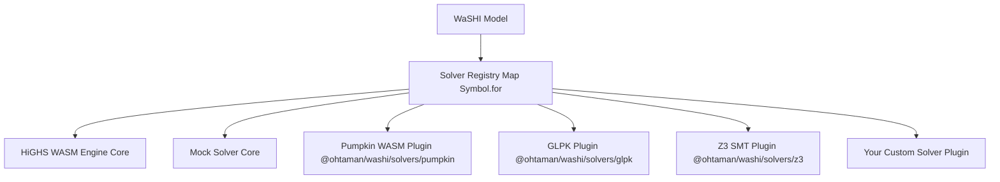

# WaSHI カスタムソルバー開発ガイド

このガイドでは、**WaSHI**（`@ohtaman/washi`）向けに独自のソルバープラグインを実装・テスト・配布する方法を説明します。

コアの `@ohtaman/washi` は HiGHS WebAssembly エンジンと `MockSolver` を同梱しています。`@ohtaman/washi/solvers/pumpkin` は制約プログラミング（CP）プラグインを提供します。WebAssembly・ネイティブ C++・Web Worker・クラウド REST/RPC など任意のバックエンドを登録し、共通の `Model` API から呼び出せます。

---

## 1. プラグインアーキテクチャの概要



### アーキテクチャの特徴

- **統一グローバルレジストリ**: `Symbol.for("washi.solverRegistry")` で管理し、ESM チャンクや `<script>` 間で同一マップを共有します。
- **環境に依存しない一貫性**: Node.js とブラウザで同一のソルバー名解決・能力チェック・エラーメッセージを提供します。
- **疎結合バンドル**: コアパッケージは任意・カスタムプラグインをインポートせず、各プラグインは読み込まれたときにのみ自身を登録します。

---

## 2. API コントラクトと TypeScript 型定義

すべてのカスタムソルバーは、`@ohtaman/washi` からエクスポートされる `Solver` インターフェースを実装します。

```typescript
import {
  generateLpString,
  buildLpSymbolMaps,
  isLpExportResult,
  sanitizeIdentifier,
  type Solver,
  type SolverOptions,
  type SolverResult,
  type SolverCheckResult,
  type SolverCapabilities,
  type SolveModelData,
  type CheckModelData,
  type LogicalConstraintItem,
  type LpModelData,
  type LpExportResult,
  type LpSymbolMaps,
  type SolverStatus,
  type TerminationStatus,
  type SolveProgressEvent,
} from "@ohtaman/washi";
```

### `Solver` インターフェース

```typescript
export interface Solver {
  /** ソルバーの一意な表示名 (例: "GLPK", "AcmeCloudSolver") */
  readonly name: string;

  /** ソルバーのバージョン文字列 (例: "1.2.0") */
  readonly version?: string;

  /** 対応している問題クラスを宣言する能力フラグ */
  readonly capabilities?: SolverCapabilities;

  /** このソルバーインスタンスに設定された既定オプション */
  readonly options?: SolverOptions;

  /**
   * 数理最適化モデル（LP, MIP, QP, CP, SMT）の主求解メソッド。
   */
  solve(
    modelData: SolveModelData,
    options?: SolverOptions
  ): Promise<SolverResult>;

  /**
   * 目的関数なしの充足可能性・実行可能性判定用メソッド（任意）。
   */
  check?(
    modelData: CheckModelData,
    options?: SolverOptions
  ): Promise<SolverCheckResult>;
}
```

### `CheckModelData` と `SolveModelData`

`Model.solve()` と `Model.check()` は、事前に線形計画（LP）文字列へ変換せず、構造化されたモデルスナップショットをアダプターへ直接渡します。

```typescript
export interface CheckModelData {
  name?: string;
  variables: Var[];
  boolVars?: BoolVar[];
  constraints: Constraint[];
  logicalConstraints?: LogicalConstraintItem[];
}

export interface SolveModelData extends CheckModelData {
  sense: OptimizationSense;
  objective: LinExpr | QuadExpr;
}
```

### `SolverCapabilities`

対応機能は `capabilities` で宣言します。`Model` は `solve()` や `check()` を呼ぶ前に次の条件を検証します。

- **二次目的関数（`QuadExpr`）**: `supportsQP === false` の場合はエラーを投げます。
- **ウォームスタート（`initialValue`）**: `supportsWarmStart !== true` の場合はエラーを投げます。
- **論理制約**: `supportsLogicalConstraints` または `supportsSMT` が `true` なら `modelData.logicalConstraints` をそのまま渡します。
- **混合整数計画（MIP）への自動線形化**: いずれの論理フラグも `true` でない場合、`Model` が論理制約を等価なバイナリ変数と線形制約へ自動変換してから `solve()` を呼びます。

```typescript
export interface SolverCapabilities {
  /** 混合整数計画法（整数・バイナリ変数）のサポート */
  supportsMIP?: boolean;

  /** 二次目的関数（QP）のサポート */
  supportsQP?: boolean;

  /** 二次制約または二次錐制約（QCQP / SOCP）のサポート */
  supportsQCQP?: boolean;

  /** 充足可能性モジュロ理論（SMT）および論理制約のサポート */
  supportsSMT?: boolean;

  /** SMT 連続理論を伴わない命題論理制約のネイティブサポート */
  supportsLogicalConstraints?: boolean;

  /** Unsat Core（矛盾する制約の部分集合）抽出のサポート */
  supportsUnsatCore?: boolean;

  /** 初期値ヒント / ウォームスタート（Var.initialValue）のサポート */
  supportsWarmStart?: boolean;
}
```

### `SolverOptions` と `SolveProgressEvent`

`solve()` と `check()` に渡される実行時オプションは `SolverOptions` に従います。ルーティング用の `solver` フィールドはアダプターへ渡される前に `Model` 側で取り除かれます。

```typescript
export interface SolverOptions {
  /** 最大実行時間（秒） */
  timeLimit?: number;

  /** 前処理モード */
  presolve?: "on" | "off" | "choose";

  /** 相対 MIP ギャップ許容値（例: 1% なら 0.01） */
  relativeGap?: number;

  /** 絶対 MIP ギャップ許容値 */
  absoluteGap?: number;

  /** 並列スレッド数 */
  threads?: number;

  /** ソルバーのコンソールログ出力を有効化 */
  verbose?: boolean;

  /** 整数・バイナリ変数を緩和した連続 LP 緩和問題を解く */
  relax?: boolean;

  /** ブラウザで非同期実行するための Web Worker を使用 */
  useWorker?: boolean;

  /** 実行中の求解を中断するための AbortSignal */
  signal?: AbortSignal;

  /** 正規化された SolveProgressEvent を受け取る進捗コールバック */
  onProgress?: (progress: SolveProgressEvent) => void;

  /** その他のソルバー固有オプション */
  [key: string]: any;
}
```

### 構造化モデルデータの直接利用と LP ヘルパーの使い分け

バックエンドが受け付ける入力形式に応じて、モデルデータの扱い方を選びます。

- **モデルデータを直接使う**: 構造化オブジェクトを扱うバックエンド向け（`PumpkinSolver`・`GLPKSolver`・`Z3Solver` と同方式）。
- **LP ヘルパーを使う**: バックエンドが CPLEX / HiGHS 形式の LP テキストや制限付き ASCII 識別子を必要とする場合。

| ヘルパー関数 | 用途 |
| :--- | :--- |
| `generateLpString(modelData, { relax }?)` | `modelData` を CPLEX LP 文字列（`lpString`）と衝突安全な逆引きマップ（`nameToVar`・`nameToConstraint`）へ変換。`{ relax: true }` で連続緩和 LP を出力。 |
| `buildLpSymbolMaps(modelData)` | LP 文字列を生成せず、サニタイズ済み識別子マップ（`nameToVar`・`varToName`・`nameToConstraint`・`constraintToName`）だけを構築。 |
| `isLpExportResult(value)` | `LpExportResult` の実行時型ガード（旧来の 3 引数オーバーロード互換用）。 |
| `sanitizeIdentifier(raw, fallbackPrefix = "x", id = 0)` | 任意の変数名・制約名を LP 形式で有効な識別子へ変換。 |

```typescript
export interface LpExportResult {
  lpString: string;
  nameToVar: Map<string, Var>;
  nameToConstraint: Map<string, Constraint>;
}
```

### `SolverResult` の正規化と識別子の復元

`solve()` が返す `values`・`boolValues`・`reducedCosts`・`duals`・`slacks` は、モデルの元の名前（`v.name`・`bv.name`・`c.name`）をキーにする必要があります。LP ヘルパーを使った場合は、`nameToVar` と `nameToConstraint` で元の名前へ復元してください。

```typescript
export interface SolverResult {
  status: SolverStatus;
  terminationStatus?: TerminationStatus;
  hasPrimalSolution?: boolean;
  objectiveValue: number | null;
  objectiveBound?: number;
  relativeGap?: number;
  absoluteGap?: number;
  values: Record<string, number>;
  boolValues?: Record<string, boolean>;
  reducedCosts?: Record<string, number>;
  duals?: Record<string, number>;
  slacks?: Record<string, number>;
  runTime?: number;
  logs?: string[];
  raw?: any;
}
```

#### 標準化された `SolverStatus` の値

- `"Optimal"`: 最適解を取得（MIP は許容誤差内、LP は最適性証明済み）。
- `"Feasible"`: 実行可能な暫定解はあるが、最適性は未証明。
- `"Infeasible"`: モデルが実行不可能と証明された。
- `"Unbounded"`: 目的関数が非有界。
- `"TimeLimit"`: 暫定解や最適性証明のないまま `timeLimit` に到達。
- `"IterationLimit"`: 反復回数上限に到達。
- `"Sat"` / `"Unsat"`: `check()` または SMT ソルバーの充足可能 / 充足不能ステータス。
- `"Error"` / `"NotSolved"` / `"Unknown"`: 失敗・未求解・未認識ステータス。`"Unknown"` や `"Error"` を `"Optimal"` へ変換してはいけません。

---

## 3. ステップバイステップ実装チュートリアル

### チュートリアル A: 社内クラウド REST ソルバーアダプター

次は、`generateLpString` でオンデマンドに CPLEX LP 文字列を生成し、HTTP マイクロサービスへ送信して求解するカスタムソルバーの実装例です。

```typescript
import {
  generateLpString,
  registerSolver,
  type Solver,
  type SolverOptions,
  type SolverResult,
  type SolverStatus,
  type SolveModelData,
} from "@ohtaman/washi";

export interface CloudSolverConfig extends SolverOptions {
  endpoint?: string;
  apiKey?: string;
}

export class CloudSolver implements Solver {
  public readonly name = "CloudSolver";
  public readonly version = "1.0.0";
  public readonly capabilities = {
    supportsMIP: true,
    supportsQP: false,
  };

  private endpoint: string;
  private apiKey: string;

  constructor(config: CloudSolverConfig = {}) {
    this.endpoint = config.endpoint || "https://solver.mycompany.internal/v1/solve";
    this.apiKey = config.apiKey || "";
  }

  async solve(
    modelData: SolveModelData,
    options: SolverOptions = {}
  ): Promise<SolverResult> {
    const startTime = performance.now();
    const { lpString, nameToVar, nameToConstraint } = generateLpString(modelData, {
      relax: options.relax,
    });

    let payload: any;
    try {
      const response = await fetch(this.endpoint, {
        method: "POST",
        headers: {
          "Content-Type": "application/json",
          ...(this.apiKey ? { Authorization: `Bearer ${this.apiKey}` } : {}),
        },
        body: JSON.stringify({
          lp: lpString,
          timeLimit: options.timeLimit,
          relativeGap: options.relativeGap,
          absoluteGap: options.absoluteGap,
        }),
        signal: options.signal,
      });

      if (!response.ok) {
        throw new Error(`[CloudSolver] Server returned HTTP ${response.status}: ${await response.text()}`);
      }

      payload = await response.json();
    } catch (err: any) {
      if (options.signal?.aborted || err?.name === "AbortError") {
        return {
          status: "Unknown",
          terminationStatus: "Interrupted",
          objectiveValue: null,
          values: {},
          runTime: (performance.now() - startTime) / 1000,
        };
      }
      throw err;
    }

    const runTime = (performance.now() - startTime) / 1000;

    const values: Record<string, number> = Object.create(null);
    for (const [k, val] of Object.entries((payload.values || {}) as Record<string, number>)) {
      values[nameToVar.get(k)?.name ?? k] = val;
    }
    const duals: Record<string, number> = Object.create(null);
    for (const [k, val] of Object.entries((payload.duals || {}) as Record<string, number>)) {
      duals[nameToConstraint.get(k)?.name ?? k] = val;
    }
    const slacks: Record<string, number> = Object.create(null);
    for (const [k, val] of Object.entries((payload.slacks || {}) as Record<string, number>)) {
      slacks[nameToConstraint.get(k)?.name ?? k] = val;
    }

    const statusMap: Record<string, SolverStatus> = {
      OPTIMAL: "Optimal",
      FEASIBLE: "Feasible",
      INFEASIBLE: "Infeasible",
      UNBOUNDED: "Unbounded",
      TIME_LIMIT: "TimeLimit",
      TIMELIMIT: "TimeLimit",
      ITERATION_LIMIT: "IterationLimit",
      ERROR: "Error",
      NOT_SOLVED: "NotSolved",
      SAT: "Sat",
      UNSAT: "Unsat",
    };
    const rawStatus: SolverStatus = statusMap[String(payload.status).toUpperCase()] ?? "Unknown";
    const hasIncumbent =
      (typeof payload.objectiveValue === "number" && Number.isFinite(payload.objectiveValue)) ||
      Object.values(values).some((val) => typeof val === "number" && Number.isFinite(val));
    const isLimitStop = rawStatus === "TimeLimit" || rawStatus === "IterationLimit";
    const status: SolverStatus = isLimitStop && hasIncumbent ? "Feasible" : rawStatus;

    return {
      status,
      terminationStatus: rawStatus,
      objectiveValue: payload.objectiveValue ?? null,
      values,
      duals,
      slacks,
      runTime: payload.solveDuration || runTime,
      logs: payload.logs || [],
      raw: payload,
    };
  }
}

// `import "my-cloud-solver"` で `solver: "cloud"` が使えるように自動登録
export function registerCloudSolver(): void {
  registerSolver("cloud", (opts) => new CloudSolver(opts));
}
registerCloudSolver();
```

---

### チュートリアル B: カスタムソルバーの登録と利用方法

設定を全体で共有するかリクエスト単位で変えるかに応じて、次の 3 つの方法から選びます。

| 方法 | 向いている用途 |
| :--- | :--- |
| **登録名文字列** | 既定設定のプラグインを再利用する場合（`solver: "cloud"`）。 |
| **ソルバーインスタンス** | リクエストごとに認証情報・エンドポイント・オプションを変えたい場合。 |
| **グローバルデフォルト（`setDefaultSolver`）** | 各 `new Model()` を書き換えずにアプリ全体で既定ソルバーを切り替えたい場合。 |

#### 方法 1: 登録名文字列で指定する

```typescript
import { Model } from "@ohtaman/washi";
import "./cloud-solver.js"; // "cloud" を自動登録

const model = new Model({ name: "SupplyChain", solver: "cloud" });
// または await model.solve({ solver: "cloud" })
```

#### 方法 2: ソルバーインスタンスを直接渡す

```typescript
import { Model } from "@ohtaman/washi";
import { CloudSolver } from "./cloud-solver.js";

const customInstance = new CloudSolver({
  endpoint: "https://dedicated-gpu-cluster.internal/solve",
  apiKey: "secret-token",
});

const model = new Model({ name: "FacilityLocation", solver: customInstance });
const status = await model.solve();
```

#### 方法 3: グローバルなデフォルトソルバーとして設定する

```typescript
import { setDefaultSolver, Model } from "@ohtaman/washi";
import { CloudSolver } from "./cloud-solver.js";

setDefaultSolver(() => new CloudSolver());

// 以降に作成されるすべてのモデルはデフォルトで CloudSolver を使用します
const model = new Model("DefaultedModel");
```

---

## 4. 配布: 独立したプラグインパッケージとして公開する

カスタムソルバーを独立した npm パッケージ（例：`@my-org/washi-solver-cplex`）として公開するには、`package.json` で Node ESM とブラウザ用のエントリーポイントを宣言します。

### 1. `package.json` の `exports` 構成

```json
{
  "name": "@my-org/washi-solver-cplex",
  "version": "1.0.0",
  "type": "module",
  "main": "./dist/lib/index.js",
  "types": "./dist/types/index.d.ts",
  "exports": {
    ".": {
      "types": "./dist/types/index.d.ts",
      "import": "./dist/lib/index.js",
      "default": "./dist/lib/index.js"
    },
    "./browser": {
      "types": "./dist/types/index.d.ts",
      "import": "./dist/browser/index.js",
      "default": "./dist/browser/index.js"
    },
    "./browser/index.min.js": "./dist/browser/index.min.js"
  },
  "peerDependencies": {
    "@ohtaman/washi": ">=0.1.0"
  }
}
```

### 2. ブラウザ向け単体ビルド（IIFE）

ブラウザ用 `.min.js` バンドルを出力する際は、Vite や Rollup で即時実行関数式（`iife`）を設定します。

- **出力フォーマット**: `iife`
- **グローバル変数名**: `WashiCplex`
- **レジストリ連携**: `Symbol.for("washi.solverRegistry")` により、`washi.min.js` の後に読み込むだけで自動登録されます。

---

## 5. カスタムソルバーのテスト

ネットワーク通信をモックすれば、バンドルなしで Vitest や Jest から直接アダプターをテストできます。

```typescript
import { describe, it, expect, vi } from "vitest";
import { Model, expr, maximize, registerSolver, listAvailableSolvers } from "@ohtaman/washi";
import { CloudSolver } from "./cloud-solver.js";

describe("Custom Solver Integration", () => {
  it("registers in available solvers list", () => {
    registerSolver("cloud-test", () => new CloudSolver());
    expect(listAvailableSolvers()).toContain("cloud-test");
  });

  it("propagates primal values and duals into WaSHI Model", async () => {
    const fetchSpy = vi.spyOn(globalThis, "fetch").mockResolvedValueOnce(
      new Response(
        JSON.stringify({
          status: "OPTIMAL",
          objectiveValue: 34,
          values: { x: 2, y: 10 },
          duals: { budget: 2 },
        }),
        { status: 200, headers: { "Content-Type": "application/json" } }
      )
    );

    try {
      const model = new Model({ solver: new CloudSolver() });
      const x = model.continuous("x", { lb: 0, ub: 10 });
      const y = model.continuous("y", { lb: 0, ub: 10 });
      model.objective(maximize(expr`2 * ${x} + 3 * ${y}`));
      model.constraint(expr`${x} + ${y} <= 12`, "budget");

      const status = await model.solve();
      expect(status).toBe("Optimal");
      expect(x.value).toBe(2);
      const c1 = model.constraints.get("budget");
      expect(c1?.dual).toBe(2);
    } finally {
      fetchSpy.mockRestore();
    }
  });
});
```
