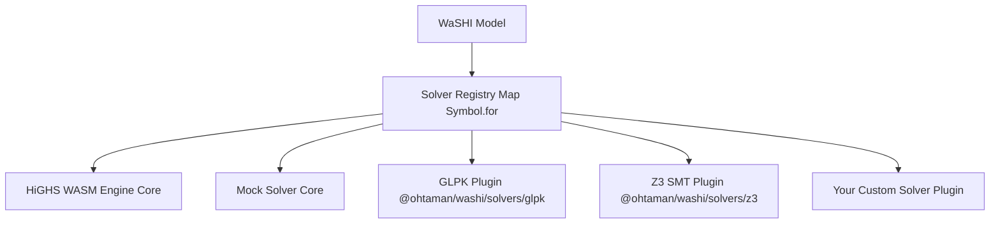

# WaSHI Custom Solver Developer Guide

This guide describes how to build, test, and distribute custom solver plugins for **WaSHI** (`@ohtaman/washi`).

WaSHI features a pluggable, decoupled solver architecture. Core `@ohtaman/washi` bundles only the zero-config HiGHS WASM engine and a Mock solver. Any third-party solver—whether implemented in WebAssembly, native C++, a Web Worker, or an external cloud REST/RPC backend—can be registered and used through the unified `Model` API.

---

## 1. Pluggable Solvers Architecture Overview



### Key Architectural Characteristics
1. **Unified Global Registry**: The solver registry is backed by `Symbol.for("washi.solverRegistry")` on `globalThis`. This ensures that even across different ESM chunks, dynamic imports, or `<script>` tags, every bundle accesses the identical solver map.
2. **Behavioral Symmetry**: Node.js and browser environments share identical error messages, solver naming, and capability handling.
3. **Decoupled Bundling**: Core WaSHI does not import optional or custom plugins. A plugin only registers itself when explicitly imported.

---

## 2. API Contracts & TypeScript Interfaces

All custom solvers must implement the `Solver` interface defined in `@ohtaman/washi`:

```typescript
import {
  generateLpString,
  buildLpSymbolMaps,
  isLpExportResult,
  sanitizeIdentifier,
  type Solver,
  type SolverOptions,
  type SolverResult,
  type SolverCheckResult,
  type SolverCapabilities,
  type SolveModelData,
  type CheckModelData,
  type LogicalConstraintItem,
  type LpModelData,
  type LpExportResult,
  type LpSymbolMaps,
  type SolverStatus,
  type TerminationStatus,
  type SolveProgressEvent,
} from "@ohtaman/washi";
```

### The `Solver` Interface

```typescript
export interface Solver {
  /** Unique human-readable name of the solver (e.g. "GLPK", "AcmeCloudSolver") */
  readonly name: string;

  /** Solver version string (e.g. "1.2.0") */
  readonly version?: string;

  /** Capability flags declaring which problem classes the solver supports */
  readonly capabilities?: SolverCapabilities;

  /**
   * Main solve method for LP, MIP, QP, and SMT optimization models.
   *
   * @param modelData Typed in-memory model structure (variables, constraints, objective, sense, boolVars, logicalConstraints)
   * @param options Runtime execution options (timeLimit, mipGap, verbose, signal, onProgress, etc.)
   */
  solve(
    modelData: SolveModelData,
    options?: SolverOptions
  ): Promise<SolverResult>;

  /**
   * Optional check method for Pure SAT / SMT or feasibility checking without an objective.
   *
   * @param modelData Objective-free in-memory model structure (variables, boolVars, constraints, logicalConstraints)
   * @param options Runtime execution options
   */
  check?(
    modelData: CheckModelData,
    options?: SolverOptions
  ): Promise<SolverCheckResult>;
}
```

### `CheckModelData` & `SolveModelData`

`Model.solve()` and `Model.check()` pass the structured model directly to your adapter without serializing an LP string upfront:

```typescript
export interface CheckModelData {
  /** Model name */
  name?: string;
  /** Decision variables registered in the model */
  variables: Var[];
  /** Propositional Boolean variables registered in the model */
  boolVars?: BoolVar[];
  /** Linear arithmetic constraints registered in the model */
  constraints: Constraint[];
  /** Logical / SMT constraints registered in the model */
  logicalConstraints?: LogicalConstraintItem[];
}

export interface SolveModelData extends CheckModelData {
  /** Optimization direction ("Minimize" | "Maximize") */
  sense: OptimizationSense;
  /** Linear or quadratic objective expression */
  objective: LinExpr | QuadExpr;
}
```

### `SolverCapabilities`

Custom solvers declare their supported features using `capabilities`. Before dispatching `solve()` or `check()`, `Model` validates:
- `supportsQP === false` when the objective contains quadratic terms (`QuadExpr`),
- `supportsSMT !== true` when the model contains logical constraints (`m.logicalConstraints`), and
- `supportsWarmStart !== true` when any variable has a primal `initialValue` set.

```typescript
export interface SolverCapabilities {
  /** Supports mixed-integer programming (integer/binary variables) */
  supportsMIP?: boolean;

  /** Supports quadratic objectives (QP: x^T Q x + c^T x) */
  supportsQP?: boolean;

  /** Supports second-order cone or quadratic constraints */
  supportsQCQP?: boolean;

  /** Supports satisfiability modulo theories / boolean logic constraints */
  supportsSMT?: boolean;

  /** Supports extracting an unsatisfiable core (conflicting constraint subset) */
  supportsUnsatCore?: boolean;

  /** Supports primal initial values / MIP warm starts (Var.initialValue) */
  supportsWarmStart?: boolean;
}
```

### `SolverOptions` & `SolveProgressEvent`

Runtime options passed to `solve` and `check` include cancellation and progress hooks (note that the routing `solver` field from `SolveOptions` is stripped before options are passed to your adapter):

```typescript
export interface SolverOptions {
  /** Time limit in seconds */
  timeLimit?: number;

  /** Relative MIP optimality gap tolerance */
  mipGap?: number;

  /** Enable solver console logging */
  verbose?: boolean;

  /** Cooperative cancellation signal; when aborted, return terminationStatus: "Interrupted" */
  signal?: AbortSignal;

  /** Progress callback invoked with normalized SolveProgressEvent snapshots */
  onProgress?: (progress: SolveProgressEvent) => void;

  /** Additional solver-specific options */
  [key: string]: any;
}
```

### Optional LP Serialization & Symbol-Mapping Helpers

Solvers that consume structured JS/WASM data (such as `GLPKSolver` and `Z3Solver`) work directly with `SolveModelData` / `CheckModelData`.
If your adapter targets a backend that requires CPLEX/HiGHS LP text or restricted identifier syntax, WaSHI exports opt-in helpers:

- `generateLpString(modelData): LpExportResult` — serializes `modelData` into a CPLEX LP format string (`lpString`) along with collision-safe symbol lookup maps (`nameToVar`, `nameToConstraint`).
- `buildLpSymbolMaps(modelData): LpSymbolMaps` — builds collision-safe sanitized symbol maps (`nameToVar`, `varToName`, `nameToConstraint`, `constraintToName`) without serializing an LP string.
- `isLpExportResult(value): value is LpExportResult` — runtime type guard for `LpExportResult` (useful when supporting legacy 3-argument `solve(modelData, lpResult, options)` overloads).
- `sanitizeIdentifier(raw, fallbackPrefix = "x", id = 0)` — sanitizes an arbitrary display name into a valid LP identifier.

```typescript
export interface LpExportResult {
  /** Standard CPLEX/HiGHS LP formatted string */
  lpString: string;

  /** Map translating sanitized LP variable identifiers back to WaSHI Var objects */
  nameToVar: Map<string, Var>;

  /** Map translating sanitized LP constraint identifiers back to WaSHI Constraint objects */
  nameToConstraint: Map<string, Constraint>;
}
```

### `SolverResult` Normalization & Identity Decoding

The `solve` method must return normalized results keyed by the model's canonical variable/constraint names (`v.name`, `bv.name`, `c.name`). Adapters that use `generateLpString(modelData)` or `buildLpSymbolMaps(modelData)` for an LP backend must translate sanitized LP identifiers back to canonical model names using `nameToVar` and `nameToConstraint`:

```typescript
export interface SolverResult {
  /** Standardized status string */
  status: SolverStatus;

  /** Exact termination reason independent of whether a feasible incumbent is available (defaults to status) */
  terminationStatus?: TerminationStatus;

  /** Whether a feasible primal solution / incumbent is available (inferred from status/values if omitted) */
  hasPrimalSolution?: boolean;

  /** Optimal or best objective value (null if no primal solution is available) */
  objectiveValue: number | null;

  /** Best proven dual/objective bound when provided by the solver */
  objectiveBound?: number;

  /** Relative MIP optimality gap when provided by the solver */
  relGap?: number;

  /** Alias for relGap: relative MIP optimality gap when provided by the solver */
  mipGap?: number;

  /** Absolute MIP optimality gap |objectiveValue - objectiveBound| (computed automatically when both are finite) */
  absGap?: number;

  /** Variable primal values keyed by canonical variable name (non-finite values are ignored) */
  values: Record<string, number>;

  /** Propositional Boolean variable assignments keyed by BoolVar name (optional, SMT/SAT) */
  boolValues?: Record<string, boolean>;

  /** Variable reduced costs (optional, LP only) */
  reducedCosts?: Record<string, number>;

  /** Constraint dual values / shadow prices (optional, LP only) */
  duals?: Record<string, number>;

  /** Constraint slack values (optional) */
  slacks?: Record<string, number>;

  /** Solve execution duration in seconds */
  runTime?: number;

  /** Diagnostic solver logs / text outputs */
  logs?: string[];

  /** Raw solver response object for inspection */
  raw?: any;
}
```

#### Standardized `SolverStatus` Values
- `"Optimal"`: Global optimal solution found (for MIP within tolerance, for LP proven optimal).
- `"Feasible"`: Feasible solution found, but optimality not yet proven (e.g., hit time limit with an incumbent).
- `"Infeasible"`: Model is proven mathematically infeasible.
- `"Unbounded"`: Model objective is unbounded.
- `"TimeLimit"`: Solver terminated due to `timeLimit` without proof of optimality.
- `"IterationLimit"`: Solver terminated due to iteration limit.
- `"Sat"` / `"Unsat"`: Satisfiable / unsatisfiable status returned by `check()` or SMT solvers.
- `"Error"` / `"NotSolved"` / `"Unknown"`: Error, not yet solved, or unrecognized status. **Never convert Unknown/Error to Optimal.**

---

## 3. Step-by-Step Implementation Tutorials

### Tutorial A: In-House Cloud REST Solver Adapter

Here is a complete, production-ready custom solver connecting to an HTTP microservice that accepts LP format strings on demand via `generateLpString(modelData)`:

```typescript
import {
  generateLpString,
  registerSolver,
  type Solver,
  type SolverOptions,
  type SolverResult,
  type SolverStatus,
  type SolveModelData,
} from "@ohtaman/washi";

export interface CloudSolverConfig extends SolverOptions {
  endpoint?: string;
  apiKey?: string;
}

export class CloudSolver implements Solver {
  public readonly name = "CloudSolver";
  public readonly version = "1.0.0";
  public readonly capabilities = {
    supportsMIP: true,
    supportsQP: false,
  };

  private endpoint: string;
  private apiKey: string;

  constructor(config: CloudSolverConfig = {}) {
    this.endpoint = config.endpoint || "https://solver.mycompany.internal/v1/solve";
    this.apiKey = config.apiKey || "";
  }

  async solve(
    modelData: SolveModelData,
    options: SolverOptions = {}
  ): Promise<SolverResult> {
    const startTime = performance.now();
    const { lpString, nameToVar, nameToConstraint } = generateLpString(modelData);

    let payload: any;
    try {
      const response = await fetch(this.endpoint, {
        method: "POST",
        headers: {
          "Content-Type": "application/json",
          ...(this.apiKey ? { Authorization: `Bearer ${this.apiKey}` } : {}),
        },
        body: JSON.stringify({
          lp: lpString,
          timeLimit: options.timeLimit,
          mipGap: options.mipGap,
        }),
        signal: options.signal,
      });

      if (!response.ok) {
        throw new Error(`[CloudSolver] Server returned HTTP ${response.status}: ${await response.text()}`);
      }

      payload = await response.json();
    } catch (err: any) {
      if (options.signal?.aborted || err?.name === "AbortError") {
        return {
          status: "Unknown",
          terminationStatus: "Interrupted",
          objectiveValue: null,
          values: {},
          runTime: (performance.now() - startTime) / 1000,
        };
      }
      throw err;
    }

    const runTime = (performance.now() - startTime) / 1000;

    const values: Record<string, number> = Object.create(null);
    for (const [k, val] of Object.entries((payload.values || {}) as Record<string, number>)) {
      values[nameToVar.get(k)?.name ?? k] = val;
    }
    const duals: Record<string, number> = Object.create(null);
    for (const [k, val] of Object.entries((payload.duals || {}) as Record<string, number>)) {
      duals[nameToConstraint.get(k)?.name ?? k] = val;
    }
    const slacks: Record<string, number> = Object.create(null);
    for (const [k, val] of Object.entries((payload.slacks || {}) as Record<string, number>)) {
      slacks[nameToConstraint.get(k)?.name ?? k] = val;
    }

    const statusMap: Record<string, SolverStatus> = {
      OPTIMAL: "Optimal",
      FEASIBLE: "Feasible",
      INFEASIBLE: "Infeasible",
      UNBOUNDED: "Unbounded",
      TIME_LIMIT: "TimeLimit",
      TIMELIMIT: "TimeLimit",
      ITERATION_LIMIT: "IterationLimit",
      ERROR: "Error",
      NOT_SOLVED: "NotSolved",
      SAT: "Sat",
      UNSAT: "Unsat",
    };
    const rawStatus: SolverStatus = statusMap[String(payload.status).toUpperCase()] ?? "Unknown";
    const hasIncumbent =
      (typeof payload.objectiveValue === "number" && Number.isFinite(payload.objectiveValue)) ||
      Object.values(values).some((val) => typeof val === "number" && Number.isFinite(val));
    const isLimitStop = rawStatus === "TimeLimit" || rawStatus === "IterationLimit";
    const status: SolverStatus = isLimitStop && hasIncumbent ? "Feasible" : rawStatus;

    return {
      status,
      terminationStatus: rawStatus,
      objectiveValue: payload.objectiveValue ?? null,
      values,
      duals,
      slacks,
      runTime: payload.solveDuration || runTime,
      logs: payload.logs || [],
      raw: payload,
    };
  }
}

// Auto-register so `import "my-cloud-solver"` enables `solver: "cloud"`
export function registerCloudSolver(): void {
  registerSolver("cloud", (opts) => new CloudSolver(opts));
}
registerCloudSolver();
```

---

### Tutorial B: Registering and Using the Custom Solver

Once implemented, the custom solver can be selected in three different ways:

#### Option 1: By Registered Name String
```typescript
import { Model } from "@ohtaman/washi";
import "./cloud-solver.js"; // Auto-registers "cloud"

const model = new Model({ name: "SupplyChain", solver: "cloud" });
// Or model.solve("cloud")
```

#### Option 2: By Passing the Solver Instance Directly
```typescript
import { Model } from "@ohtaman/washi";
import { CloudSolver } from "./cloud-solver.js";

const customInstance = new CloudSolver({
  endpoint: "https://dedicated-gpu-cluster.internal/solve",
  apiKey: "secret-token",
});

const model = new Model({ name: "FacilityLocation", solver: customInstance });
const status = await model.solve();
```

#### Option 3: Setting Global Default Solver
```typescript
import { setDefaultSolver, Model } from "@ohtaman/washi";
import { CloudSolver } from "./cloud-solver.js";

setDefaultSolver(() => new CloudSolver());

// All subsequent models use CloudSolver by default
const model = new Model("DefaultedModel");
```

---

## 4. Distribution: Packaging as a Plugin

To publish your solver as an independent npm package (e.g. `@my-org/washi-solver-cplex`):

### 1. `package.json` Exports Structure
```json
{
  "name": "@my-org/washi-solver-cplex",
  "version": "1.0.0",
  "type": "module",
  "main": "./dist/lib/index.js",
  "types": "./dist/types/index.d.ts",
  "exports": {
    ".": {
      "types": "./dist/types/index.d.ts",
      "import": "./dist/lib/index.js",
      "default": "./dist/lib/index.js"
    },
    "./browser": {
      "types": "./dist/types/index.d.ts",
      "import": "./dist/browser/index.js",
      "default": "./dist/browser/index.js"
    },
    "./browser/index.min.js": "./dist/browser/index.min.js"
  },
  "peerDependencies": {
    "@ohtaman/washi": ">=0.1.0"
  }
}
```

### 2. Browser IIFE Build
When building the browser standalone script (`.min.js`), configure your bundler (Vite or Rollup) to:
- Output format: `iife`
- Global name: `WashiCplex`
- Rely on `Symbol.for("washi.solverRegistry")` so that `<script src="washi.min.js"></script><script src="washi-cplex.min.js"></script>` automatically connects.

---

## 5. Testing Your Custom Solver

You can test your solver using Vitest or Jest without bundling:

```typescript
import { describe, it, expect, vi } from "vitest";
import { Model, expr, maximize, registerSolver, listAvailableSolvers } from "@ohtaman/washi";
import { CloudSolver } from "./cloud-solver.js";

describe("Custom Solver Integration", () => {
  it("registers in available solvers list", () => {
    registerSolver("cloud-test", () => new CloudSolver());
    expect(listAvailableSolvers()).toContain("cloud-test");
  });

  it("propagates primal values and duals into WaSHI Model", async () => {
    const fetchSpy = vi.spyOn(globalThis, "fetch").mockResolvedValueOnce(
      new Response(
        JSON.stringify({
          status: "OPTIMAL",
          objectiveValue: 34,
          values: { x: 2, y: 10 },
          duals: { budget: 2 },
        }),
        { status: 200, headers: { "Content-Type": "application/json" } }
      )
    );

    try {
      const model = new Model({ solver: new CloudSolver() });
      const x = model.continuous("x", { lb: 0, ub: 10 });
      const y = model.continuous("y", { lb: 0, ub: 10 });
      model.objective(maximize(expr`2 * ${x} + 3 * ${y}`));
      model.constraint(expr`${x} + ${y} <= 12`, "budget");

      const status = await model.solve();
      expect(status).toBe("Optimal");
      expect(x.value).toBe(2);
      const c1 = model.getConstraintByName("budget");
      expect(c1?.dual).toBe(2);
    } finally {
      fetchSpy.mockRestore();
    }
  });
});
```
