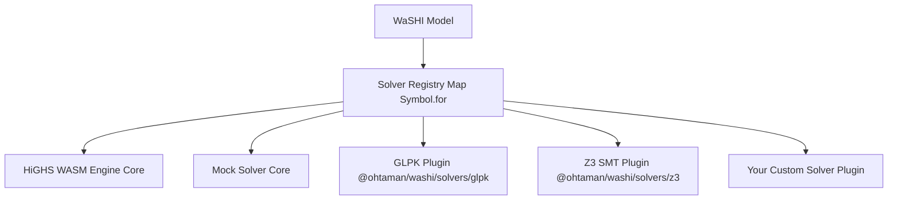

# WaSHI Custom Solver Developer Guide

This guide describes how to build, test, and distribute custom solver plugins for **WaSHI** (`@ohtaman/washi`).

WaSHI features a pluggable, decoupled solver architecture. Core `@ohtaman/washi` bundles only the zero-config HiGHS WASM engine and a Mock solver. Any third-party solver—whether implemented in WebAssembly, native C++, a Web Worker, or an external cloud REST/RPC backend—can be registered and used through the unified `Model` API.

---

## 1. Pluggable Solvers Architecture Overview



### Key Architectural Characteristics
1. **Unified Global Registry**: The solver registry is backed by `Symbol.for("washi.solverRegistry")` on `globalThis`. This ensures that even across different ESM chunks, dynamic imports, or `<script>` tags, every bundle accesses the identical solver map.
2. **Behavioral Symmetry**: Node.js and browser environments share identical error messages, solver naming, and capability handling.
3. **Decoupled Bundling**: Core WaSHI does not import optional or custom plugins. A plugin only registers itself when explicitly imported.

---

## 2. API Contracts & TypeScript Interfaces

All custom solvers must implement the `Solver` interface defined in `@ohtaman/washi`:

```typescript
import type {
  Solver,
  SolverOptions,
  SolverResult,
  SolverCheckResult,
  SolverCapabilities,
  LpModelData,
  LpExportResult,
  SolverStatus,
} from "@ohtaman/washi";
```

### The `Solver` Interface

```typescript
export interface Solver {
  /** Unique human-readable name of the solver (e.g. "GLPK", "AcmeCloudSolver") */
  readonly name: string;

  /** Solver version string (e.g. "1.2.0") */
  readonly version?: string;

  /** Capability flags declaring which problem classes the solver supports */
  readonly capabilities?: SolverCapabilities;

  /**
   * Main solve method for LP, MIP, and QP optimization models.
   *
   * @param modelData In-memory model structure (variables, constraints, objective)
   * @param lpResult Serialized LP format string and symbol lookup maps
   * @param options Runtime execution options (timeLimit, mipGap, verbose, etc.)
   */
  solve(
    modelData: LpModelData,
    lpResult: LpExportResult,
    options?: SolverOptions
  ): Promise<SolverResult>;

  /**
   * Optional check method for Pure SAT / SMT satisfiability without an objective.
   */
  check?(
    modelData: any,
    options?: SolverOptions
  ): Promise<SolverCheckResult>;
}
```

### `SolverCapabilities`

Custom solvers declare their supported features using `capabilities`:

```typescript
export interface SolverCapabilities {
  /** Supports mixed-integer programming (integer/binary variables) */
  supportsMIP?: boolean;

  /** Supports quadratic objectives (QP: x^T Q x + c^T x) */
  supportsQP?: boolean;

  /** Supports second-order cone or quadratic constraints */
  supportsQCQP?: boolean;

  /** Supports satisfiability modulo theories / boolean logic constraints */
  supportsSMT?: boolean;

  /** Supports extracting an unsatisfiable core (conflicting constraint subset) */
  supportsUnsatCore?: boolean;
}
```

### `LpExportResult` & `LpModelData`

The `solve` method receives both the structured `modelData` and the standardized `lpResult`:

```typescript
export interface LpExportResult {
  /** Standard CPLEX/HiGHS LP formatted string */
  lpString: string;

  /** Map translating sanitized LP variable identifiers back to WaSHI Var objects */
  nameToVar: Map<string, Var>;

  /** Map translating sanitized LP constraint identifiers back to WaSHI Constraint objects */
  nameToConstraint: Map<string, Constraint>;
}
```

### `SolverResult` Normalization

The solve method must return normalized results:

```typescript
export interface SolverResult {
  /** Standardized status string */
  status: SolverStatus;

  /** Optimal or best objective value (null if infeasible/unbounded/error) */
  objectiveValue: number | null;

  /** Variable primal values keyed by variable name or ID */
  values: Record<string, number>;

  /** Variable reduced costs (optional, LP only) */
  reducedCosts?: Record<string, number>;

  /** Constraint dual values / shadow prices (optional, LP only) */
  duals?: Record<string, number>;

  /** Constraint slack values (optional) */
  slacks?: Record<string, number>;

  /** Solve execution duration in seconds */
  runTime?: number;

  /** Diagnostic solver logs / text outputs */
  logs?: string[];

  /** Raw solver response object for inspection */
  raw?: any;
}
```

#### Standardized `SolverStatus` Values
- `"Optimal"`: Global optimal solution found (for MIP within tolerance, for LP proven optimal).
- `"Infeasible"`: Model is proven mathematically infeasible.
- `"Unbounded"`: Model objective is unbounded.
- `"Feasible"`: Integer feasible solution found, but optimality not yet proven (e.g., hit time limit).
- `"TimeLimit"`: Solver terminated due to `timeLimit` without proof of optimality.
- `"IterationLimit"`: Solver terminated due to simplex/simplex iteration limit.
- `"Empty"`: No variables or constraints defined.
- `"Unknown"`: Error or unrecognized status. **Never convert Unknown/Error to Optimal.**

---

## 3. Step-by-Step Implementation Tutorials

### Tutorial A: In-House Cloud REST Solver Adapter

Here is a complete, production-ready custom solver connecting to an HTTP microservice:

```typescript
import {
  type Solver,
  type SolverOptions,
  type SolverResult,
  type LpModelData,
  type LpExportResult,
  registerSolver,
} from "@ohtaman/washi";

export interface CloudSolverConfig extends SolverOptions {
  endpoint?: string;
  apiKey?: string;
}

export class CloudSolver implements Solver {
  public readonly name = "CloudSolver";
  public readonly version = "1.0.0";
  public readonly capabilities = {
    supportsMIP: true,
    supportsQP: false,
  };

  private endpoint: string;
  private apiKey: string;

  constructor(config: CloudSolverConfig = {}) {
    this.endpoint = config.endpoint || "https://solver.mycompany.internal/v1/solve";
    this.apiKey = config.apiKey || "";
  }

  async solve(
    modelData: LpModelData,
    lpResult: LpExportResult,
    options: SolverOptions = {}
  ): Promise<SolverResult> {
    const startTime = performance.now();

    const response = await fetch(this.endpoint, {
      method: "POST",
      headers: {
        "Content-Type": "application/json",
        ...(this.apiKey ? { Authorization: `Bearer ${this.apiKey}` } : {}),
      },
      body: JSON.stringify({
        lp: lpResult.lpString,
        timeLimit: options.timeLimit,
        mipGap: options.mipGap,
      }),
    });

    if (!response.ok) {
      throw new Error(`[CloudSolver] Server returned HTTP ${response.status}: ${await response.text()}`);
    }

    const payload = await response.json();
    const runTime = (performance.now() - startTime) / 1000;

    return {
      status: payload.status === "OPTIMAL" ? "Optimal" : payload.status,
      objectiveValue: payload.objectiveValue ?? null,
      values: payload.values || {},
      duals: payload.duals || {},
      slacks: payload.slacks || {},
      runTime: payload.solveDuration || runTime,
      logs: payload.logs || [],
      raw: payload,
    };
  }
}

// Auto-register so `import "my-cloud-solver"` enables `solver: "cloud"`
export function registerCloudSolver(): void {
  registerSolver("cloud", (opts) => new CloudSolver(opts));
}
registerCloudSolver();
```

---

### Tutorial B: Registering and Using the Custom Solver

Once implemented, the custom solver can be selected in three different ways:

#### Option 1: By Registered Name String
```typescript
import { Model } from "@ohtaman/washi";
import "./cloud-solver.js"; // Auto-registers "cloud"

const model = new Model({ name: "SupplyChain", solver: "cloud" });
// Or model.optimize("cloud")
```

#### Option 2: By Passing the Solver Instance Directly
```typescript
import { Model } from "@ohtaman/washi";
import { CloudSolver } from "./cloud-solver.js";

const customInstance = new CloudSolver({
  endpoint: "https://dedicated-gpu-cluster.internal/solve",
  apiKey: "secret-token",
});

const model = new Model({ name: "FacilityLocation", solver: customInstance });
const status = await model.optimize();
```

#### Option 3: Setting Global Default Solver
```typescript
import { setDefaultSolver, Model } from "@ohtaman/washi";
import { CloudSolver } from "./cloud-solver.js";

setDefaultSolver(() => new CloudSolver());

// All subsequent models use CloudSolver by default
const model = new Model("DefaultedModel");
```

---

## 4. Distribution: Packaging as a Plugin

To publish your solver as an independent npm package (e.g. `@my-org/washi-solver-cplex`):

### 1. `package.json` Exports Structure
```json
{
  "name": "@my-org/washi-solver-cplex",
  "version": "1.0.0",
  "type": "module",
  "main": "./dist/lib/index.js",
  "types": "./dist/types/index.d.ts",
  "exports": {
    ".": {
      "types": "./dist/types/index.d.ts",
      "import": "./dist/lib/index.js",
      "default": "./dist/lib/index.js"
    },
    "./browser": {
      "types": "./dist/types/index.d.ts",
      "import": "./dist/browser/index.js",
      "default": "./dist/browser/index.js"
    },
    "./browser/index.min.js": "./dist/browser/index.min.js"
  },
  "peerDependencies": {
    "@ohtaman/washi": ">=0.1.0"
  }
}
```

### 2. Browser IIFE Build
When building the browser standalone script (`.min.js`), configure your bundler (Vite or Rollup) to:
- Output format: `iife`
- Global name: `WashiCplex`
- Rely on `Symbol.for("washi.solverRegistry")` so that `<script src="washi.min.js"></script><script src="washi-cplex.min.js"></script>` automatically connects.

---

## 5. Testing Your Custom Solver

You can test your solver using Vitest or Jest without bundling:

```typescript
import { describe, it, expect } from "vitest";
import { Model, registerSolver, listAvailableSolvers } from "@ohtaman/washi";
import { CloudSolver } from "./cloud-solver.js";

describe("Custom Solver Integration", () => {
  it("registers in available solvers list", () => {
    registerSolver("cloud-test", () => new CloudSolver());
    expect(listAvailableSolvers()).toContain("cloud-test");
  });

  it("propagates primal values and duals into WaSHI Model", async () => {
    const model = new Model({ solver: new CloudSolver() });
    const x = model.addVar({ name: "x", lb: 0, ub: 10 });
    const y = model.addVar({ name: "y", lb: 0, ub: 10 });
    model.maximize(x.mul(2).add(y.mul(3)));
    const c1 = model.addConstraint(x.add(y).le(12), "budget");

    const status = await model.optimize();
    expect(status).toBe("Optimal");
    expect(x.value).toBeDefined();
    expect(c1.dual).toBeDefined();
  });
});
```
