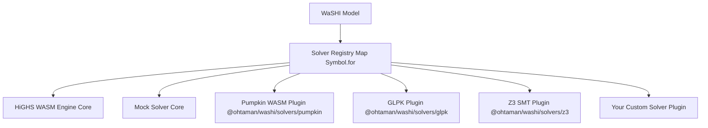

# WaSHI Custom Solver Developer Guide

This guide explains how to build, test, and distribute custom solver plugins for **WaSHI** (`@ohtaman/washi`).

Core `@ohtaman/washi` bundles the HiGHS WebAssembly engine and `MockSolver`, while `@ohtaman/washi/solvers/pumpkin` provides a bundled Constraint Programming (CP) plugin. You can register any other backend—WebAssembly, native C++, Web Worker, or cloud REST/RPC—and use it through the same `Model` API.

---

## 1. Pluggable Solvers Architecture Overview



### Key Architectural Characteristics

- **Unified global registry**: Stored under `Symbol.for("washi.solverRegistry")` on `globalThis`, so separate ESM chunks, dynamic imports, and `<script>` tags share one solver map.
- **Cross-runtime symmetry**: Node.js and browser builds share identical solver naming, capability checks, and error messages.
- **Decoupled bundling**: Core WaSHI never imports optional or custom plugins; each plugin registers itself only when imported.

---

## 2. API Contracts & TypeScript Interfaces

Every custom solver implements the `Solver` interface exported from `@ohtaman/washi`:

```typescript
import {
  generateLpString,
  buildLpSymbolMaps,
  isLpExportResult,
  sanitizeIdentifier,
  type Solver,
  type SolverOptions,
  type SolverResult,
  type SolverCheckResult,
  type SolverCapabilities,
  type SolveModelData,
  type CheckModelData,
  type LogicalConstraintItem,
  type LpModelData,
  type LpExportResult,
  type LpSymbolMaps,
  type SolverStatus,
  type TerminationStatus,
  type SolveProgressEvent,
} from "@ohtaman/washi";
```

### The `Solver` Interface

```typescript
export interface Solver {
  /** Identifier name of the solver engine (e.g. "GLPK", "AcmeCloudSolver") */
  readonly name: string;

  /** Version string of the solver (e.g. "1.2.0") */
  readonly version?: string;

  /** Feature capabilities of this solver */
  readonly capabilities?: SolverCapabilities;

  /** Default options configured on this solver instance */
  readonly options?: SolverOptions;

  /**
   * Solve a mathematical programming model (LP, MIP, QP, CP, or SMT).
   */
  solve(
    modelData: SolveModelData,
    options?: SolverOptions
  ): Promise<SolverResult>;

  /**
   * Optional objective-free satisfiability / feasibility check (SAT / SMT / CP).
   */
  check?(
    modelData: CheckModelData,
    options?: SolverOptions
  ): Promise<SolverCheckResult>;
}
```

### `CheckModelData` & `SolveModelData`

`Model.solve()` and `Model.check()` pass structured model snapshots directly to your adapter without serializing a Linear Programming (LP) string upfront:

```typescript
export interface CheckModelData {
  name?: string;
  variables: Var[];
  boolVars?: BoolVar[];
  constraints: Constraint[];
  logicalConstraints?: LogicalConstraintItem[];
}

export interface SolveModelData extends CheckModelData {
  sense: OptimizationSense;
  objective: LinExpr | QuadExpr;
}
```

### `SolverCapabilities`

Declare supported features on `capabilities`. Before calling `solve()` or `check()`, `Model` checks these flags:

- **Quadratic objectives (`QuadExpr`)**: Rejected if `supportsQP === false`.
- **Warm starts (`initialValue`)**: Rejected if `supportsWarmStart !== true`.
- **Logical constraints**: Passed natively in `modelData.logicalConstraints` when `supportsLogicalConstraints === true` or Satisfiability Modulo Theories (`supportsSMT === true`) is enabled.
- **Automatic Mixed-Integer Programming (MIP) linearization**: When neither logical flag is `true`, `Model` converts logical constraints into equivalent binary variables and linear constraints before calling `solve()`.

```typescript
export interface SolverCapabilities {
  /** Supports Mixed-Integer Programming (integer and binary variables) */
  supportsMIP?: boolean;

  /** Supports Quadratic Programming objectives (QP) */
  supportsQP?: boolean;

  /** Supports quadratic constraints (QCQP / SOCP) */
  supportsQCQP?: boolean;

  /** Supports Satisfiability Modulo Theories (SMT) and logical constraints */
  supportsSMT?: boolean;

  /** Supports native boolean/propositional logical constraints without SMT continuous theories */
  supportsLogicalConstraints?: boolean;

  /** Supports extracting an unsatisfiable core (conflicting constraint subset) */
  supportsUnsatCore?: boolean;

  /** Supports primal initial values / warm-start hints (Var.initialValue) */
  supportsWarmStart?: boolean;
}
```

### `SolverOptions` & `SolveProgressEvent`

Runtime options passed to `solve()` and `check()` follow `SolverOptions`. Note that `Model` strips the routing `solver` field before forwarding options to your adapter.

```typescript
export interface SolverOptions {
  /** Maximum solve time limit in seconds */
  timeLimit?: number;

  /** Presolve mode */
  presolve?: "on" | "off" | "choose";

  /** Relative MIP gap tolerance (e.g. 0.01 for 1%) */
  relativeGap?: number;

  /** Absolute MIP gap tolerance */
  absoluteGap?: number;

  /** Number of parallel threads */
  threads?: number;

  /** Enable verbose solver logging */
  verbose?: boolean;

  /** Solve the continuous LP relaxation by relaxing integer and binary variables */
  relax?: boolean;

  /** Use Web Worker for non-blocking browser execution */
  useWorker?: boolean;

  /** AbortSignal to cancel an in-flight solve */
  signal?: AbortSignal;

  /** Callback invoked with normalized SolveProgressEvent metrics */
  onProgress?: (progress: SolveProgressEvent) => void;

  /** Additional solver-specific options */
  [key: string]: any;
}
```

### Direct Model Data vs. LP Helpers

Choose how your adapter reads `modelData` based on your backend's input format:

- **Use `SolveModelData` / `CheckModelData` directly** when your backend accepts structured JS or WebAssembly objects (as `PumpkinSolver`, `GLPKSolver`, and `Z3Solver` do).
- **Use WaSHI's opt-in LP helpers** when your backend expects CPLEX/HiGHS LP text or restricted ASCII identifiers:

| Helper | Purpose |
| :--- | :--- |
| `generateLpString(modelData, { relax }?)` | Serializes `modelData` into a CPLEX LP string (`lpString`) with collision-safe `nameToVar` and `nameToConstraint` maps; pass `{ relax: true }` to emit continuous LP relaxation. |
| `buildLpSymbolMaps(modelData)` | Builds collision-safe sanitized symbol maps (`nameToVar`, `varToName`, `nameToConstraint`, `constraintToName`) without serializing an LP string. |
| `isLpExportResult(value)` | Runtime type guard for `LpExportResult` (useful for legacy 3-argument `solve(modelData, lpResult, options)` overloads). |
| `sanitizeIdentifier(raw, fallbackPrefix = "x", id = 0)` | Converts an arbitrary variable or constraint name into a valid LP identifier. |

```typescript
export interface LpExportResult {
  lpString: string;
  nameToVar: Map<string, Var>;
  nameToConstraint: Map<string, Constraint>;
}
```

### `SolverResult` Normalization & Identity Decoding

`solve()` must key returned `values`, `boolValues`, `reducedCosts`, `duals`, and `slacks` by the model's canonical names (`v.name`, `bv.name`, `c.name`). When using LP helpers, decode sanitized LP identifiers back via `nameToVar` and `nameToConstraint`.

```typescript
export interface SolverResult {
  status: SolverStatus;
  terminationStatus?: TerminationStatus;
  hasPrimalSolution?: boolean;
  objectiveValue: number | null;
  objectiveBound?: number;
  relativeGap?: number;
  absoluteGap?: number;
  values: Record<string, number>;
  boolValues?: Record<string, boolean>;
  reducedCosts?: Record<string, number>;
  duals?: Record<string, number>;
  slacks?: Record<string, number>;
  runTime?: number;
  logs?: string[];
  raw?: any;
}
```

#### Standardized `SolverStatus` Values

- `"Optimal"`: Optimal solution found (within MIP tolerance, or proven optimal for LP).
- `"Feasible"`: Feasible incumbent found, but optimality is not yet proven.
- `"Infeasible"`: Model is proven infeasible.
- `"Unbounded"`: Model objective is unbounded.
- `"TimeLimit"`: Stopped by `timeLimit` without an incumbent or optimality proof.
- `"IterationLimit"`: Stopped by an iteration limit.
- `"Sat"` / `"Unsat"`: Satisfiable / unsatisfiable status from `check()` or SMT solvers.
- `"Error"` / `"NotSolved"` / `"Unknown"`: Failure, unsolved, or unrecognized status. Never map `"Unknown"` or `"Error"` to `"Optimal"`.

---

## 3. Step-by-Step Implementation Tutorials

### Tutorial A: In-House Cloud REST Solver Adapter

This example builds a custom solver that calls an HTTP microservice accepting CPLEX LP strings generated on demand with `generateLpString`:

```typescript
import {
  generateLpString,
  registerSolver,
  type Solver,
  type SolverOptions,
  type SolverResult,
  type SolverStatus,
  type SolveModelData,
} from "@ohtaman/washi";

export interface CloudSolverConfig extends SolverOptions {
  endpoint?: string;
  apiKey?: string;
}

export class CloudSolver implements Solver {
  public readonly name = "CloudSolver";
  public readonly version = "1.0.0";
  public readonly capabilities = {
    supportsMIP: true,
    supportsQP: false,
  };

  private endpoint: string;
  private apiKey: string;

  constructor(config: CloudSolverConfig = {}) {
    this.endpoint = config.endpoint || "https://solver.mycompany.internal/v1/solve";
    this.apiKey = config.apiKey || "";
  }

  async solve(
    modelData: SolveModelData,
    options: SolverOptions = {}
  ): Promise<SolverResult> {
    const startTime = performance.now();
    const { lpString, nameToVar, nameToConstraint } = generateLpString(modelData, {
      relax: options.relax,
    });

    let payload: any;
    try {
      const response = await fetch(this.endpoint, {
        method: "POST",
        headers: {
          "Content-Type": "application/json",
          ...(this.apiKey ? { Authorization: `Bearer ${this.apiKey}` } : {}),
        },
        body: JSON.stringify({
          lp: lpString,
          timeLimit: options.timeLimit,
          relativeGap: options.relativeGap,
          absoluteGap: options.absoluteGap,
        }),
        signal: options.signal,
      });

      if (!response.ok) {
        throw new Error(`[CloudSolver] Server returned HTTP ${response.status}: ${await response.text()}`);
      }

      payload = await response.json();
    } catch (err: any) {
      if (options.signal?.aborted || err?.name === "AbortError") {
        return {
          status: "Unknown",
          terminationStatus: "Interrupted",
          objectiveValue: null,
          values: {},
          runTime: (performance.now() - startTime) / 1000,
        };
      }
      throw err;
    }

    const runTime = (performance.now() - startTime) / 1000;

    const values: Record<string, number> = Object.create(null);
    for (const [k, val] of Object.entries((payload.values || {}) as Record<string, number>)) {
      values[nameToVar.get(k)?.name ?? k] = val;
    }
    const duals: Record<string, number> = Object.create(null);
    for (const [k, val] of Object.entries((payload.duals || {}) as Record<string, number>)) {
      duals[nameToConstraint.get(k)?.name ?? k] = val;
    }
    const slacks: Record<string, number> = Object.create(null);
    for (const [k, val] of Object.entries((payload.slacks || {}) as Record<string, number>)) {
      slacks[nameToConstraint.get(k)?.name ?? k] = val;
    }

    const statusMap: Record<string, SolverStatus> = {
      OPTIMAL: "Optimal",
      FEASIBLE: "Feasible",
      INFEASIBLE: "Infeasible",
      UNBOUNDED: "Unbounded",
      TIME_LIMIT: "TimeLimit",
      TIMELIMIT: "TimeLimit",
      ITERATION_LIMIT: "IterationLimit",
      ERROR: "Error",
      NOT_SOLVED: "NotSolved",
      SAT: "Sat",
      UNSAT: "Unsat",
    };
    const rawStatus: SolverStatus = statusMap[String(payload.status).toUpperCase()] ?? "Unknown";
    const hasIncumbent =
      (typeof payload.objectiveValue === "number" && Number.isFinite(payload.objectiveValue)) ||
      Object.values(values).some((val) => typeof val === "number" && Number.isFinite(val));
    const isLimitStop = rawStatus === "TimeLimit" || rawStatus === "IterationLimit";
    const status: SolverStatus = isLimitStop && hasIncumbent ? "Feasible" : rawStatus;

    return {
      status,
      terminationStatus: rawStatus,
      objectiveValue: payload.objectiveValue ?? null,
      values,
      duals,
      slacks,
      runTime: payload.solveDuration || runTime,
      logs: payload.logs || [],
      raw: payload,
    };
  }
}

// Auto-register so `import "my-cloud-solver"` enables `solver: "cloud"`
export function registerCloudSolver(): void {
  registerSolver("cloud", (opts) => new CloudSolver(opts));
}
registerCloudSolver();
```

---

### Tutorial B: Registering and Using the Custom Solver

Choose how to attach your solver based on whether configuration is shared globally or varies per request:

| Method | Best For |
| :--- | :--- |
| **Registered name string** | Reusable plugins with default settings (`solver: "cloud"`). |
| **Solver instance** | Per-request credentials, endpoints, or custom option presets. |
| **Global default (`setDefaultSolver`)** | Replacing HiGHS across an entire application without updating every `new Model()`. |

#### Option 1: By Registered Name String

```typescript
import { Model } from "@ohtaman/washi";
import "./cloud-solver.js"; // Auto-registers "cloud"

const model = new Model({ name: "SupplyChain", solver: "cloud" });
// Or await model.solve({ solver: "cloud" })
```

#### Option 2: By Passing the Solver Instance Directly

```typescript
import { Model } from "@ohtaman/washi";
import { CloudSolver } from "./cloud-solver.js";

const customInstance = new CloudSolver({
  endpoint: "https://dedicated-gpu-cluster.internal/solve",
  apiKey: "secret-token",
});

const model = new Model({ name: "FacilityLocation", solver: customInstance });
const status = await model.solve();
```

#### Option 3: Setting Global Default Solver

```typescript
import { setDefaultSolver, Model } from "@ohtaman/washi";
import { CloudSolver } from "./cloud-solver.js";

setDefaultSolver(() => new CloudSolver());

// All subsequent models use CloudSolver by default
const model = new Model("DefaultedModel");
```

---

## 4. Distribution: Packaging as a Plugin

To publish your solver as an independent npm package (such as `@my-org/washi-solver-cplex`), declare Node ESM and browser entry points in `package.json`:

### 1. `package.json` Exports Structure

```json
{
  "name": "@my-org/washi-solver-cplex",
  "version": "1.0.0",
  "type": "module",
  "main": "./dist/lib/index.js",
  "types": "./dist/types/index.d.ts",
  "exports": {
    ".": {
      "types": "./dist/types/index.d.ts",
      "import": "./dist/lib/index.js",
      "default": "./dist/lib/index.js"
    },
    "./browser": {
      "types": "./dist/types/index.d.ts",
      "import": "./dist/browser/index.js",
      "default": "./dist/browser/index.js"
    },
    "./browser/index.min.js": "./dist/browser/index.min.js"
  },
  "peerDependencies": {
    "@ohtaman/washi": ">=0.1.0"
  }
}
```

### 2. Browser Standalone Build (IIFE)

When building a browser `.min.js` bundle, configure Vite or Rollup for Immediately Invoked Function Expression (`iife`) output:

- **Output format**: `iife`
- **Global name**: `WashiCplex`
- **Registry linking**: Because registration uses `Symbol.for("washi.solverRegistry")`, loading `<script src="washi.min.js"></script>` followed by `<script src="washi-cplex.min.js"></script>` connects automatically.

---

## 5. Testing Your Custom Solver

You can test your adapter directly in Vitest or Jest without bundling by mocking network calls:

```typescript
import { describe, it, expect, vi } from "vitest";
import { Model, expr, maximize, registerSolver, listAvailableSolvers } from "@ohtaman/washi";
import { CloudSolver } from "./cloud-solver.js";

describe("Custom Solver Integration", () => {
  it("registers in available solvers list", () => {
    registerSolver("cloud-test", () => new CloudSolver());
    expect(listAvailableSolvers()).toContain("cloud-test");
  });

  it("propagates primal values and duals into WaSHI Model", async () => {
    const fetchSpy = vi.spyOn(globalThis, "fetch").mockResolvedValueOnce(
      new Response(
        JSON.stringify({
          status: "OPTIMAL",
          objectiveValue: 34,
          values: { x: 2, y: 10 },
          duals: { budget: 2 },
        }),
        { status: 200, headers: { "Content-Type": "application/json" } }
      )
    );

    try {
      const model = new Model({ solver: new CloudSolver() });
      const x = model.continuous("x", { lb: 0, ub: 10 });
      const y = model.continuous("y", { lb: 0, ub: 10 });
      model.objective(maximize(expr`2 * ${x} + 3 * ${y}`));
      model.constraint(expr`${x} + ${y} <= 12`, "budget");

      const status = await model.solve();
      expect(status).toBe("Optimal");
      expect(x.value).toBe(2);
      const c1 = model.constraints.get("budget");
      expect(c1?.dual).toBe(2);
    } finally {
      fetchSpy.mockRestore();
    }
  });
});
```
