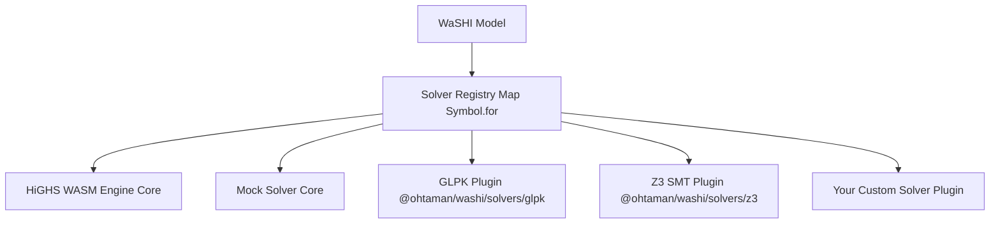

# WaSHI 自定义求解器开发指南

本指南介绍如何为 **WaSHI**（`@ohtaman/washi`）构建、测试和发布自定义求解器插件。

WaSHI 采用可插拔、解耦的求解器架构。核心包 `@ohtaman/washi` 仅内置零配置的 HiGHS WASM 引擎和 Mock 求解器。任何第三方求解器——无论是通过 WebAssembly、原生 C++ 插件、Web Worker，还是外部云端 REST/RPC 后端实现——都可以注册并通过统一的 `Model` API 进行调用。

---

## 1. 可插拔求解器架构概览



### 核心架构特征
1. **统一的全局注册表**：求解器注册表基于 `globalThis` 上的 `Symbol.for("washi.solverRegistry")` 构建。这确保了即使跨不同的 ESM 代码分块、动态导入或 `<script>` 标签，所有模块访问的都是同一个求解器映射表。
2. **跨环境行为一致性**：Node.js 与浏览器环境共享完全一致的错误提示、求解器命名规则与能力检测逻辑。
3. **解耦打包**：WaSHI 核心包不导入任何可选或自定义插件，插件仅在被显式导入时才会注册自身。

---

## 2. API 契约与 TypeScript 接口

所有自定义求解器都必须实现 `@ohtaman/washi` 中定义的 `Solver` 接口：

```typescript
import {
  generateLpString,
  buildLpSymbolMaps,
  isLpExportResult,
  sanitizeIdentifier,
  type Solver,
  type SolverOptions,
  type SolverResult,
  type SolverCheckResult,
  type SolverCapabilities,
  type SolveModelData,
  type CheckModelData,
  type LogicalConstraintItem,
  type LpModelData,
  type LpExportResult,
  type LpSymbolMaps,
  type SolverStatus,
  type TerminationStatus,
  type SolveProgressEvent,
} from "@ohtaman/washi";
```

### `Solver` 接口定义

```typescript
export interface Solver {
  /** 求解器的唯一可读名称（例如 "GLPK", "AcmeCloudSolver"） */
  readonly name: string;

  /** 求解器版本号字符串（例如 "1.2.0"） */
  readonly version?: string;

  /** 声明该求解器支持哪些问题类型的能力标志 */
  readonly capabilities?: SolverCapabilities;

  /**
   * 求解 LP、MIP、QP 和 SMT 优化模型的主方法。
   *
   * @param modelData 内存中的强类型模型结构（variables, constraints, objective, sense, boolVars, logicalConstraints）
   * @param options 运行时执行选项（timeLimit, mipGap, verbose, signal, onProgress 等）
   */
  solve(
    modelData: SolveModelData,
    options?: SolverOptions
  ): Promise<SolverResult>;

  /**
   * 可选的可满足性检查方法，用于纯 SAT / SMT 或无目标函数的可行性判定。
   *
   * @param modelData 无目标函数的内存模型结构（variables, boolVars, constraints, logicalConstraints）
   * @param options 运行时执行选项
   */
  check?(
    modelData: CheckModelData,
    options?: SolverOptions
  ): Promise<SolverCheckResult>;
}
```

### `CheckModelData` 与 `SolveModelData`

`Model.solve()` 与 `Model.check()` 会将结构化的模型数据直接传递给你的适配器，而不会预先序列化 LP 字符串：

```typescript
export interface CheckModelData {
  /** 模型名称 */
  name?: string;
  /** 模型中注册的决策变量 */
  variables: Var[];
  /** 模型中注册的命题布尔变量 */
  boolVars?: BoolVar[];
  /** 模型中注册的线性算术约束 */
  constraints: Constraint[];
  /** 模型中注册的逻辑 / SMT 约束 */
  logicalConstraints?: LogicalConstraintItem[];
}

export interface SolveModelData extends CheckModelData {
  /** 优化方向（"Minimize" | "Maximize"） */
  sense: OptimizationSense;
  /** 线性或二次目标函数表达式 */
  objective: LinExpr | QuadExpr;
}
```

### `SolverCapabilities`

自定义求解器通过 `capabilities` 声明其支持的功能特性。在分发调用 `solve()` 或 `check()` 之前，`Model` 会自动校验以下能力标志：
- 当目标函数包含二次项（`QuadExpr`）时检查 `supportsQP === false`；
- 当模型包含逻辑约束（`m.logicalConstraints`）时检查 `supportsSMT !== true`；
- 当任意变量设置了初始值（`initialValue`）时检查 `supportsWarmStart !== true`。

```typescript
export interface SolverCapabilities {
  /** 支持混合整数规划（整数/二元变量） */
  supportsMIP?: boolean;

  /** 支持二次目标函数（QP: x^T Q x + c^T x） */
  supportsQP?: boolean;

  /** 支持二阶锥或二次约束 */
  supportsQCQP?: boolean;

  /** 支持可满足性模理论（SMT）/ 布尔逻辑约束 */
  supportsSMT?: boolean;

  /** 支持提取不可行核心（冲突约束子集） */
  supportsUnsatCore?: boolean;

  /** 支持原始初始值 / MIP 热启动（Var.initialValue） */
  supportsWarmStart?: boolean;
}
```

### `SolverOptions` 与 `SolveProgressEvent`

传递给 `solve` 和 `check` 的运行时选项包含取消信号与进度回调钩子（注意：`SolveOptions` 中用于路由的 `solver` 字段会在传递给适配器之前被剥离）：

```typescript
export interface SolverOptions {
  /** 求解时间上限（秒） */
  timeLimit?: number;

  /** 相对 MIP 最优间隙容差 */
  mipGap?: number;

  /** 启用求解器控制台日志输出 */
  verbose?: boolean;

  /** 协作式取消信号；中止时应返回 terminationStatus: "Interrupted" */
  signal?: AbortSignal;

  /** 进度回调函数，接收标准化的 SolveProgressEvent 快照 */
  onProgress?: (progress: SolveProgressEvent) => void;

  /** 其他求解器专属选项 */
  [key: string]: any;
}
```

### 可选的 LP 序列化与符号映射辅助函数

直接消费结构化 JS/WASM 数据的求解器（如 `GLPKSolver` 和 `Z3Solver`）可以直接使用 `SolveModelData` / `CheckModelData`。
如果你的适配器对接的后端需要 CPLEX/HiGHS LP 格式文本或受限的标识符语法，WaSHI 导出了按需使用的辅助函数：

- `generateLpString(modelData): LpExportResult` — 将 `modelData` 序列化为 CPLEX LP 格式字符串（`lpString`），并生成防冲突的符号查找映射表（`nameToVar`、`nameToConstraint`）。
- `buildLpSymbolMaps(modelData): LpSymbolMaps` — 在不序列化 LP 字符串的情况下，构建防冲突的规范化符号映射表（`nameToVar`、`varToName`、`nameToConstraint`、`constraintToName`）。
- `isLpExportResult(value): value is LpExportResult` — `LpExportResult` 的运行时类型守卫（用于兼容旧版三参数 `solve(modelData, lpResult, options)` 重载）。
- `sanitizeIdentifier(raw, fallbackPrefix = "x", id = 0)` — 将任意显示名称转换为合法的 LP 标识符。

```typescript
export interface LpExportResult {
  /** 标准 CPLEX/HiGHS LP 格式字符串 */
  lpString: string;

  /** 将规范化后的 LP 变量标识符还原为 WaSHI Var 对象的映射表 */
  nameToVar: Map<string, Var>;

  /** 将规范化后的 LP 约束标识符还原为 WaSHI Constraint 对象的映射表 */
  nameToConstraint: Map<string, Constraint>;
}
```

### `SolverResult` 标准化与标识符解码

`solve` 方法必须返回以模型原始变量名和约束名（`v.name`、`bv.name`、`c.name`）为键的标准化结果。使用 `generateLpString(modelData)` 或 `buildLpSymbolMaps(modelData)` 的适配器必须通过 `nameToVar` 和 `nameToConstraint` 将 LP 标识符还原为模型中的原始名称：

```typescript
export interface SolverResult {
  /** 标准化的求解状态字符串 */
  status: SolverStatus;

  /** 独立于是否存在可行解的精确终止原因（默认与 status 相同） */
  terminationStatus?: TerminationStatus;

  /** 是否存在可行原始解 / 整数暂定解（省略时根据 status 和 values 自动推断） */
  hasPrimalSolution?: boolean;

  /** 最优或当前最佳目标函数值（无原始可行解时为 null） */
  objectiveValue: number | null;

  /** 求解器提供的最佳对偶界 / 目标函数界 */
  objectiveBound?: number;

  /** 求解器提供的相对 MIP 最优间隙 */
  relGap?: number;

  /** relGap 的别名：求解器提供的相对 MIP 最优间隙 */
  mipGap?: number;

  /** 绝对 MIP 最优间隙 |objectiveValue - objectiveBound|（当两者均为有限值时自动计算） */
  absGap?: number;

  /** 以原始变量名为键的变量取值映射（非有限数值会被忽略） */
  values: Record<string, number>;

  /** 以 BoolVar 名称为键的命题布尔变量赋值映射（可选，用于 SMT/SAT） */
  boolValues?: Record<string, boolean>;

  /** 变量的缩减成本（可选，仅限 LP） */
  reducedCosts?: Record<string, number>;

  /** 约束的对偶值 / 影子价格（可选，仅限 LP） */
  duals?: Record<string, number>;

  /** 约束的松弛量（可选） */
  slacks?: Record<string, number>;

  /** 求解执行耗时（秒） */
  runTime?: number;

  /** 求解器诊断日志 / 文本输出 */
  logs?: string[];

  /** 供调试检查的原始求解器响应对象 */
  raw?: any;
}
```

#### 标准化的 `SolverStatus` 取值
- `"Optimal"`：找到全局最优解（MIP 在容差范围内最优，LP 已证明全局最优）。
- `"Feasible"`：已找到可行解，但尚未证明全局最优（例如达到时间上限时存在暂定解）。
- `"Infeasible"`：从数学上证明模型不可行。
- `"Unbounded"`：模型目标函数无界。
- `"TimeLimit"`：因达到 `timeLimit` 而终止，尚未证明最优性。
- `"IterationLimit"`：因达到单纯形法或节点迭代上限而终止。
- `"Sat"` / `"Unsat"`：`check()` 或 SMT 求解器返回的可满足 / 不可满足状态。
- `"Error"` / `"NotSolved"` / `"Unknown"`：发生错误、尚未求解或状态无法识别。**切勿将 Unknown/Error 转换为 Optimal。**

---

## 3. 分步实现教程

### 教程 A：内部云端 REST 求解器适配器

下面是一个完整的生产级自定义求解器示例，它通过 `generateLpString(modelData)` 按需生成 LP 字符串，并连接到接收 LP 格式的 HTTP 微服务：

```typescript
import {
  generateLpString,
  registerSolver,
  type Solver,
  type SolverOptions,
  type SolverResult,
  type SolverStatus,
  type SolveModelData,
} from "@ohtaman/washi";

export interface CloudSolverConfig extends SolverOptions {
  endpoint?: string;
  apiKey?: string;
}

export class CloudSolver implements Solver {
  public readonly name = "CloudSolver";
  public readonly version = "1.0.0";
  public readonly capabilities = {
    supportsMIP: true,
    supportsQP: false,
  };

  private endpoint: string;
  private apiKey: string;

  constructor(config: CloudSolverConfig = {}) {
    this.endpoint = config.endpoint || "https://solver.mycompany.internal/v1/solve";
    this.apiKey = config.apiKey || "";
  }

  async solve(
    modelData: SolveModelData,
    options: SolverOptions = {}
  ): Promise<SolverResult> {
    const startTime = performance.now();
    const { lpString, nameToVar, nameToConstraint } = generateLpString(modelData);

    let payload: any;
    try {
      const response = await fetch(this.endpoint, {
        method: "POST",
        headers: {
          "Content-Type": "application/json",
          ...(this.apiKey ? { Authorization: `Bearer ${this.apiKey}` } : {}),
        },
        body: JSON.stringify({
          lp: lpString,
          timeLimit: options.timeLimit,
          mipGap: options.mipGap,
        }),
        signal: options.signal,
      });

      if (!response.ok) {
        throw new Error(`[CloudSolver] Server returned HTTP ${response.status}: ${await response.text()}`);
      }

      payload = await response.json();
    } catch (err: any) {
      if (options.signal?.aborted || err?.name === "AbortError") {
        return {
          status: "Unknown",
          terminationStatus: "Interrupted",
          objectiveValue: null,
          values: {},
          runTime: (performance.now() - startTime) / 1000,
        };
      }
      throw err;
    }

    const runTime = (performance.now() - startTime) / 1000;

    const values: Record<string, number> = Object.create(null);
    for (const [k, val] of Object.entries((payload.values || {}) as Record<string, number>)) {
      values[nameToVar.get(k)?.name ?? k] = val;
    }
    const duals: Record<string, number> = Object.create(null);
    for (const [k, val] of Object.entries((payload.duals || {}) as Record<string, number>)) {
      duals[nameToConstraint.get(k)?.name ?? k] = val;
    }
    const slacks: Record<string, number> = Object.create(null);
    for (const [k, val] of Object.entries((payload.slacks || {}) as Record<string, number>)) {
      slacks[nameToConstraint.get(k)?.name ?? k] = val;
    }

    const statusMap: Record<string, SolverStatus> = {
      OPTIMAL: "Optimal",
      FEASIBLE: "Feasible",
      INFEASIBLE: "Infeasible",
      UNBOUNDED: "Unbounded",
      TIME_LIMIT: "TimeLimit",
      TIMELIMIT: "TimeLimit",
      ITERATION_LIMIT: "IterationLimit",
      ERROR: "Error",
      NOT_SOLVED: "NotSolved",
      SAT: "Sat",
      UNSAT: "Unsat",
    };
    const status: SolverStatus = statusMap[String(payload.status).toUpperCase()] ?? "Unknown";

    return {
      status,
      objectiveValue: payload.objectiveValue ?? null,
      values,
      duals,
      slacks,
      runTime: payload.solveDuration || runTime,
      logs: payload.logs || [],
      raw: payload,
    };
  }
}

// 自动注册，使 `import "my-cloud-solver"` 后即可使用 `solver: "cloud"`
export function registerCloudSolver(): void {
  registerSolver("cloud", (opts) => new CloudSolver(opts));
}
registerCloudSolver();
```

---

### 教程 B：注册与使用自定义求解器

实现完成后，可以通过以下三种方式选择并调用自定义求解器：

#### 方式 1：通过已注册的名称字符串指定
```typescript
import { Model } from "@ohtaman/washi";
import "./cloud-solver.js"; // 自动注册 "cloud"

const model = new Model({ name: "SupplyChain", solver: "cloud" });
// 或调用 model.solve("cloud")
```

#### 方式 2：直接传入求解器实例
```typescript
import { Model } from "@ohtaman/washi";
import { CloudSolver } from "./cloud-solver.js";

const customInstance = new CloudSolver({
  endpoint: "https://dedicated-gpu-cluster.internal/solve",
  apiKey: "secret-token",
});

const model = new Model({ name: "FacilityLocation", solver: customInstance });
const status = await model.solve();
```

#### 方式 3：设置为全局默认求解器
```typescript
import { setDefaultSolver, Model } from "@ohtaman/washi";
import { CloudSolver } from "./cloud-solver.js";

setDefaultSolver(() => new CloudSolver());

// 后续创建的所有模型默认使用 CloudSolver
const model = new Model("DefaultedModel");
```

---

## 4. 发布分发：打包为独立插件

若要将你的求解器作为独立 npm 包发布（例如 `@my-org/washi-solver-cplex`）：

### 1. `package.json` 导出结构 (`exports`)
```json
{
  "name": "@my-org/washi-solver-cplex",
  "version": "1.0.0",
  "type": "module",
  "main": "./dist/lib/index.js",
  "types": "./dist/types/index.d.ts",
  "exports": {
    ".": {
      "types": "./dist/types/index.d.ts",
      "import": "./dist/lib/index.js",
      "default": "./dist/lib/index.js"
    },
    "./browser": {
      "types": "./dist/types/index.d.ts",
      "import": "./dist/browser/index.js",
      "default": "./dist/browser/index.js"
    },
    "./browser/index.min.js": "./dist/browser/index.min.js"
  },
  "peerDependencies": {
    "@ohtaman/washi": ">=0.1.0"
  }
}
```

### 2. 浏览器 IIFE 构建
在构建浏览器端独立脚本（`.min.js`）时，请将打包工具（Vite 或 Rollup）配置为：
- 输出格式：`iife`
- 全局变量名：`WashiCplex`
- 依托 `Symbol.for("washi.solverRegistry")`，使 `<script src="washi.min.js"></script><script src="washi-cplex.min.js"></script>` 能够自动关联注册表。

---

## 5. 测试自定义求解器

无需打包即可直接使用 Vitest 或 Jest 测试你的求解器：

```typescript
import { describe, it, expect, vi } from "vitest";
import { Model, expr, maximize, registerSolver, listAvailableSolvers } from "@ohtaman/washi";
import { CloudSolver } from "./cloud-solver.js";

describe("Custom Solver Integration", () => {
  it("registers in available solvers list", () => {
    registerSolver("cloud-test", () => new CloudSolver());
    expect(listAvailableSolvers()).toContain("cloud-test");
  });

  it("propagates primal values and duals into WaSHI Model", async () => {
    const fetchSpy = vi.spyOn(globalThis, "fetch").mockResolvedValueOnce(
      new Response(
        JSON.stringify({
          status: "OPTIMAL",
          objectiveValue: 34,
          values: { x: 2, y: 10 },
          duals: { budget: 2 },
        }),
        { status: 200, headers: { "Content-Type": "application/json" } }
      )
    );

    try {
      const model = new Model({ solver: new CloudSolver() });
      const x = model.continuous("x", { lb: 0, ub: 10 });
      const y = model.continuous("y", { lb: 0, ub: 10 });
      model.objective(maximize(expr`2 * ${x} + 3 * ${y}`));
      model.constraint(expr`${x} + ${y} <= 12`, "budget");

      const status = await model.solve();
      expect(status).toBe("Optimal");
      expect(x.value).toBe(2);
      const c1 = model.getConstraintByName("budget");
      expect(c1?.dual).toBe(2);
    } finally {
      fetchSpy.mockRestore();
    }
  });
});
```
