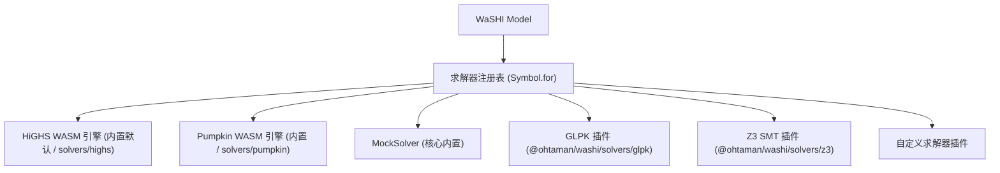

# WaSHI 自定义求解器开发指南

本指南介绍如何为 **WaSHI**（`@ohtaman/washi`）构建、测试和发布自定义求解器插件。

`@ohtaman/washi` 内置并自动注册 **HiGHS**（默认，`@ohtaman/washi/solvers/highs`）、**Pumpkin**（`@ohtaman/washi/solvers/pumpkin`）与 `MockSolver`，而可选插件（`@ohtaman/washi/solvers/glpk`、`@ohtaman/washi/solvers/z3`）在导入时注册。你还可以注册任意其他后端——如 WebAssembly、原生 C++、Web Worker 或云端 REST/RPC 服务——并通过统一的 `Model` API 调用。

---

## 1. 可插拔求解器架构概览



### 核心架构特征

- **统一全局注册表**：基于 `Symbol.for("washi.solverRegistry")` 管理，跨 ESM 分块与 `<script>` 共享同一映射表。
- **跨运行时一致性**：Node.js 与浏览器共享相同的求解器名称解析、能力校验和报错信息。
- **解耦打包**：WaSHI 核心包不导入任何可选或自定义插件，每个插件仅在被显式导入时注册自身。

---

## 2. API 契约与 TypeScript 接口

所有自定义求解器都必须实现 `@ohtaman/washi` 导出的 `Solver` 接口：

```typescript
import {
  generateLpString,
  buildLpSymbolMaps,
  isLpExportResult,
  sanitizeIdentifier,
  type Solver,
  type SolverOptions,
  type SolverResult,
  type SolverCheckResult,
  type SolverCapabilities,
  type SolveModelData,
  type CheckModelData,
  type LogicalConstraintItem,
  type LpModelData,
  type LpExportResult,
  type LpSymbolMaps,
  type SolverStatus,
  type TerminationStatus,
  type SolveProgressEvent,
} from "@ohtaman/washi";
```

### `Solver` 接口定义

```typescript
export interface Solver {
  /** 求解器引擎的唯一可读名称（例如 "GLPK", "AcmeCloudSolver"） */
  readonly name: string;

  /** 求解器版本字符串（例如 "1.2.0"） */
  readonly version?: string;

  /** 声明该求解器支持的功能特性 */
  readonly capabilities?: SolverCapabilities;

  /** 当前求解器实例上配置的默认选项 */
  readonly options?: SolverOptions;

  /**
   * 求解数学规划模型（LP、MIP、QP、CP 或 SMT）。
   */
  solve(
    modelData: SolveModelData,
    options?: SolverOptions
  ): Promise<SolverResult>;

  /**
   * 可选的无目标函数可满足性 / 可行性检查方法（SAT / SMT / CP）。
   */
  check?(
    modelData: CheckModelData,
    options?: SolverOptions
  ): Promise<SolverCheckResult>;
}
```

### `CheckModelData` 与 `SolveModelData`

`Model.solve()` 与 `Model.check()` 会直接把结构化模型快照传给适配器，不会提前序列化为 CPLEX LP 格式字符串：

```typescript
export interface CheckModelData {
  name?: string;
  variables: Var[];
  boolVars?: BoolVar[];
  constraints: Constraint[];
  logicalConstraints?: LogicalConstraintItem[];
}

export interface SolveModelData extends CheckModelData {
  sense: OptimizationSense;
  objective: LinExpr | QuadExpr;
}
```

### `SolverCapabilities`

通过 `capabilities` 声明求解器支持的能力。在调用 `solve()` 或 `check()` 之前，`Model` 会检查以下标志：

- **二次目标函数（`QuadExpr`）**：当模型包含二次目标函数且 `supportsQP === false` 时直接报错拒绝。
- **热启动（`initialValue`）**：当变量设置了 `initialValue` 且 `supportsWarmStart !== true` 时直接报错拒绝。
- **逻辑约束**：当 `supportsLogicalConstraints` 或 `supportsSMT` 为 `true` 时，通过 `modelData.logicalConstraints` 原生传递。
- **`solve()` 自动 MIP 线性化**：当两个标志均不为 `true` 时，`Model` 会在调用 `solve()` 前将 `logicalConstraints`、`boolVars` 以及非线性/CP 表达式自动转为等价的二元变量与线性约束。
- **`check()` 回退机制**：若适配器未实现 `check()`，`Model.check()` 会回退为通过 `solve()` 求解带弹性松弛变量的可行性问题（在 `conflicts` 中返回违背的约束名，`unsatCore` 为 `undefined`）。

```typescript
export interface SolverCapabilities {
  /** 支持混合整数规划（整数和二元变量） */
  supportsMIP?: boolean;

  /** 支持二次目标函数（QP） */
  supportsQP?: boolean;

  /** 支持二次约束或二阶锥约束（QCQP / SOCP） */
  supportsQCQP?: boolean;

  /** 支持可满足性模理论（SMT）与逻辑约束 */
  supportsSMT?: boolean;

  /** 原生支持布尔/命题逻辑约束，无需 SMT 连续理论 */
  supportsLogicalConstraints?: boolean;

  /** 支持提取不可行核心（冲突约束子集；不保证极小性） */
  supportsUnsatCore?: boolean;

  /** 支持原始初始值 / 热启动提示（Var.initialValue） */
  supportsWarmStart?: boolean;
}
```

### `SolverOptions` 与 `SolveProgressEvent`

传递给 `solve()` 和 `check()` 的运行时选项遵循 `SolverOptions`。用于路由的 `solver` 字段会在传递给适配器之前由 `Model` 移除。

```typescript
export interface SolverOptions {
  /** 最大求解时间（秒） */
  timeLimit?: number;

  /** 预处理模式 */
  presolve?: "on" | "off" | "choose";

  /** 相对 MIP 最优间隙容差（例如 0.01 表示 1%） */
  relativeGap?: number;

  /** 绝对 MIP 最优间隙容差 */
  absoluteGap?: number;

  /** 并行线程数 */
  threads?: number;

  /** 启用求解器控制台日志输出 */
  verbose?: boolean;

  /** 通过松弛整数与二元变量求解连续 LP 松弛问题 */
  relax?: boolean;

  /** 在浏览器中使用 Web Worker 进行非阻塞求解 */
  useWorker?: boolean;

  /** 用于取消正在进行求解的 AbortSignal */
  signal?: AbortSignal;

  /** 接收标准化 SolveProgressEvent 指标的进度回调 */
  onProgress?: (progress: SolveProgressEvent) => void;

  /** 其他求解器专属选项 */
  [key: string]: any;
}

export interface SolveProgressEvent {
  /** 求解器已运行时间（秒） */
  elapsedTime: number;
  /** elapsedTime 的别名（秒） */
  elapsedSeconds?: number;
  /** 当前求解阶段（可用时提供） */
  phase?: "simplex" | "ipm" | "mip";
  /** 当前可行暂定解的目标函数值（可用时提供） */
  objectiveValue?: number;
  /** 已证明的最佳对偶界 / 目标界（可用时提供） */
  objectiveBound?: number;
  /** 相对 MIP 最优间隙（可用时提供） */
  relativeGap?: number;
  /** 绝对 MIP 最优间隙 |objectiveValue - objectiveBound|（可用时提供） */
  absoluteGap?: number;
  /** 已探索的 MIP 分支定界节点数（可用时提供） */
  nodes?: number;
  /** 求解器迭代次数（单纯形、内点法或 MIP 的 LP 迭代） */
  iterations?: number;
  /** 求解器可选的原始进度消息 */
  message?: string;
}
```

### 直接读取模型数据 vs. 使用 LP 辅助函数

根据后端接受的输入格式决定如何读取 `modelData`：

- **直接读取模型数据**：适合接收结构化对象的后端（如 `PumpkinSolver`、`GLPKSolver` 和 `Z3Solver`）。
- **使用按需 LP 辅助函数**：适合需要 CPLEX/HiGHS LP 文本格式或受限 ASCII 标识符的后端。

| 辅助函数 | 用途 |
| :--- | :--- |
| `generateLpString(modelData, { relax }?)` | 将 `modelData` 序列化为 CPLEX LP 字符串（`lpString`）及防冲突映射表（`nameToVar`、`nameToConstraint`）；传入 `{ relax: true }` 输出连续 LP 松弛。注意它不包含 `modelData.objective.constant`，适配器需自行将其加回 `objectiveValue` 与 `objectiveBound`。 |
| `buildLpSymbolMaps(modelData)` | 在不序列化 LP 字符串的前提下构建防冲突符号映射表（`nameToVar`、`varToName`、`nameToConstraint`、`constraintToName`）。 |
| `isLpExportResult(value)` | `LpExportResult` 的运行时类型守卫（用于兼容旧版三参数重载 `solve(modelData, lpResult, options)`）。 |
| `sanitizeIdentifier(raw, fallbackPrefix = "x", id = 0)` | 将任意变量名或约束名转换为合法的 LP 标识符。 |

```typescript
export interface LpExportResult {
  lpString: string;
  nameToVar: Map<string, Var>;
  nameToConstraint: Map<string, Constraint>;
}
```

### `SolverResult` 与 `SolverCheckResult` 标准化与标识符还原

`solve()` 返回的 `values`、`boolValues`、`reducedCosts`、`duals` 与 `slacks` 必须以模型原始名称（`v.name`、`bv.name`、`c.name`）为键。`check()` 同样需以原始名称（`v.name`、`bv.name`、`c.name`、`lc.name`）返回 `values`、`unsatCore` 与 `conflicts`。使用 LP 辅助函数时，需通过 `nameToVar` 和 `nameToConstraint` 将 LP 标识符还原回原始名称。

```typescript
export interface SolverResult {
  status: SolverStatus;
  terminationStatus?: TerminationStatus;
  hasPrimalSolution?: boolean;
  objectiveValue: number | null;
  objectiveBound?: number;
  relativeGap?: number;
  absoluteGap?: number;
  values: Record<string, number>;
  boolValues?: Record<string, boolean>;
  reducedCosts?: Record<string, number>;
  duals?: Record<string, number>;
  slacks?: Record<string, number>;
  runTime?: number;
  logs?: string[];
  raw?: any;
}

export interface SolverCheckResult {
  status: "Sat" | "Unsat" | "Unknown";
  values: Record<string, number | boolean>;
  unsatCore?: readonly string[];
  /** unsatCore 的别名：导致不可行的冲突约束子集 */
  conflicts?: readonly string[];
  runTime?: number;
  logs?: string[];
  raw?: any;
}
```

#### 标准化的 `SolverStatus` 取值

- `"Optimal"`：找到最优解（MIP 在容差范围内最优，或 LP 已证明全局最优）。
- `"Feasible"`：已找到可行暂定解，但尚未证明全局最优。
- `"Infeasible"`：已证明模型不可行。
- `"Unbounded"`：模型目标函数无界。
- `"TimeLimit"`：达到 `timeLimit` 而终止，且未找到可行暂定解。
- `"IterationLimit"`：达到迭代次数上限而终止，且未找到可行暂定解。
- `"Sat"` / `"Unsat"`：`check()` 或 SMT 求解器返回的可满足 / 不可满足状态。
- `"Error"` / `"NotSolved"` / `"Unknown"`：求解失败、尚未求解或未识别状态。切勿将 `"Unknown"` 或 `"Error"` 映射为 `"Optimal"`。

---

## 3. 分步实现教程

### 教程 A：内部云端 REST 求解器适配器

下面的示例实现了一个自定义求解器，它通过 `generateLpString` 按需生成 CPLEX LP 字符串并发送到 HTTP 微服务：

```typescript
import {
  generateLpString,
  registerSolver,
  type Solver,
  type SolverOptions,
  type SolverResult,
  type SolverStatus,
  type SolveModelData,
} from "@ohtaman/washi";

export interface CloudSolverConfig extends SolverOptions {
  endpoint?: string;
  apiKey?: string;
}

export class CloudSolver implements Solver {
  public readonly name = "CloudSolver";
  public readonly version = "1.0.0";
  public readonly capabilities = {
    supportsMIP: true,
    supportsQP: false,
  };
  public readonly options: SolverOptions;

  private endpoint: string;
  private apiKey: string;

  constructor(config: CloudSolverConfig = {}) {
    const { endpoint, apiKey, ...defaultOptions } = config;
    this.endpoint = endpoint || "https://solver.mycompany.internal/v1/solve";
    this.apiKey = apiKey || "";
    this.options = defaultOptions;
  }

  async solve(
    modelData: SolveModelData,
    options: SolverOptions = {}
  ): Promise<SolverResult> {
    const mergedOptions: SolverOptions = { ...this.options, ...options };
    const startTime = performance.now();
    const { lpString, nameToVar, nameToConstraint } = generateLpString(modelData, {
      relax: mergedOptions.relax,
    });

    let payload: any;
    try {
      const response = await fetch(this.endpoint, {
        method: "POST",
        headers: {
          "Content-Type": "application/json",
          ...(this.apiKey ? { Authorization: `Bearer ${this.apiKey}` } : {}),
        },
        body: JSON.stringify({
          lp: lpString,
          timeLimit: mergedOptions.timeLimit,
          relativeGap: mergedOptions.relativeGap,
          absoluteGap: mergedOptions.absoluteGap,
        }),
        signal: mergedOptions.signal,
      });

      if (!response.ok) {
        throw new Error(`[CloudSolver] Server returned HTTP ${response.status}: ${await response.text()}`);
      }

      payload = await response.json();
    } catch (err: any) {
      if (mergedOptions.signal?.aborted || err?.name === "AbortError") {
        return {
          status: "Unknown",
          terminationStatus: "Interrupted",
          hasPrimalSolution: false,
          objectiveValue: null,
          values: {},
          runTime: (performance.now() - startTime) / 1000,
        };
      }
      throw err;
    }

    const runTime = (performance.now() - startTime) / 1000;

    const values: Record<string, number> = Object.create(null);
    for (const [k, val] of Object.entries((payload.values || {}) as Record<string, number>)) {
      values[nameToVar.get(k)?.name ?? k] = val;
    }
    const duals: Record<string, number> = Object.create(null);
    for (const [k, val] of Object.entries((payload.duals || {}) as Record<string, number>)) {
      duals[nameToConstraint.get(k)?.name ?? k] = val;
    }
    const slacks: Record<string, number> = Object.create(null);
    for (const [k, val] of Object.entries((payload.slacks || {}) as Record<string, number>)) {
      slacks[nameToConstraint.get(k)?.name ?? k] = val;
    }

    const statusMap: Record<string, SolverStatus> = {
      OPTIMAL: "Optimal",
      FEASIBLE: "Feasible",
      INFEASIBLE: "Infeasible",
      UNBOUNDED: "Unbounded",
      TIME_LIMIT: "TimeLimit",
      TIMELIMIT: "TimeLimit",
      ITERATION_LIMIT: "IterationLimit",
      ERROR: "Error",
      NOT_SOLVED: "NotSolved",
      SAT: "Sat",
      UNSAT: "Unsat",
    };
    const rawStatus: SolverStatus = statusMap[String(payload.status).toUpperCase()] ?? "Unknown";
    const offset = modelData.objective?.constant ?? 0;
    const hasFiniteObj =
      typeof payload.objectiveValue === "number" && Number.isFinite(payload.objectiveValue);
    const hasIncumbent =
      hasFiniteObj ||
      Object.values(values).some((val) => typeof val === "number" && Number.isFinite(val));
    const isLimitStop = rawStatus === "TimeLimit" || rawStatus === "IterationLimit";
    const status: SolverStatus = isLimitStop && hasIncumbent ? "Feasible" : rawStatus;
    const hasPrimalSolution =
      (status === "Optimal" || status === "Feasible") && hasIncumbent;

    return {
      status,
      terminationStatus: rawStatus,
      hasPrimalSolution,
      objectiveValue: hasPrimalSolution && hasFiniteObj ? payload.objectiveValue + offset : null,
      values: hasPrimalSolution ? values : {},
      duals: hasPrimalSolution ? duals : {},
      slacks: hasPrimalSolution ? slacks : {},
      runTime: payload.solveDuration || runTime,
      logs: payload.logs || [],
      raw: payload,
    };
  }
}

// 自动注册，使 `import "my-cloud-solver"` 后即可使用 `solver: "cloud"`
export function registerCloudSolver(): void {
  registerSolver("cloud", (opts) => new CloudSolver(opts));
}
registerCloudSolver();
```

---

### 教程 B：注册与使用自定义求解器

根据配置是否全局共享，选择以下三种接入方式之一：

| 方式 | 适用场景 |
| :--- | :--- |
| **已注册名称字符串** | 使用默认配置复用插件（`solver: "cloud"`）。 |
| **直接传入求解器实例** | 每次调用或每个模型需要不同的凭证、端点或预设选项。 |
| **全局默认（`setDefaultSolver`）** | 在不修改每处 `new Model()` 的情况下全局替换默认求解器。 |

#### 方式 1：通过已注册的名称字符串指定

```typescript
import { Model } from "@ohtaman/washi";
import "./cloud-solver.js"; // 自动注册 "cloud"

const model = new Model({ name: "SupplyChain", solver: "cloud" });
// 或调用 await model.solve({ solver: "cloud" })
```

#### 方式 2：直接传入求解器实例

```typescript
import { Model } from "@ohtaman/washi";
import { CloudSolver } from "./cloud-solver.js";

const customInstance = new CloudSolver({
  endpoint: "https://dedicated-gpu-cluster.internal/solve",
  apiKey: "secret-token",
});

const model = new Model({ name: "FacilityLocation", solver: customInstance });
const status = await model.solve();
```

#### 方式 3：设置为全局默认求解器

```typescript
import { setDefaultSolver, Model } from "@ohtaman/washi";
import { CloudSolver } from "./cloud-solver.js";

setDefaultSolver(() => new CloudSolver());

// 未显式指定 solver 的模型将默认使用 CloudSolver
const model = new Model("DefaultedModel");
```

---

## 4. 发布分发：打包为独立插件

若要将求解器作为独立 npm 包发布（例如 `@my-org/washi-solver-cplex`），请在 `package.json` 中声明 Node ESM 与浏览器入口：

### 1. `package.json` 导出结构 (`exports`)

```json
{
  "name": "@my-org/washi-solver-cplex",
  "version": "1.0.0",
  "type": "module",
  "main": "./dist/lib/index.js",
  "types": "./dist/types/index.d.ts",
  "exports": {
    ".": {
      "types": "./dist/types/index.d.ts",
      "import": "./dist/lib/index.js",
      "default": "./dist/lib/index.js"
    },
    "./browser": {
      "types": "./dist/types/index.d.ts",
      "import": "./dist/browser/index.js",
      "default": "./dist/browser/index.js"
    },
    "./browser/index.min.js": "./dist/browser/index.min.js"
  },
  "peerDependencies": {
    "@ohtaman/washi": ">=0.8.0"
  }
}
```

### 2. 浏览器单文件构建（IIFE）

构建浏览器 `.min.js` 单文件包时，在 Vite 或 Rollup 中配置立即执行函数表达式（`iife`）格式：

- **输出格式**：`iife`
- **全局变量名**：`WashiCplex`
- **注册表关联**：基于 `Symbol.for("washi.solverRegistry")`，在 `washi.min.js` 之后引入即可自动注册。

---

## 5. 测试自定义求解器

通过模拟网络请求，无需打包即可直接在 Vitest 或 Jest 中测试适配器：

```typescript
import { describe, it, expect, vi } from "vitest";
import { Model, expr, maximize, registerSolver, listAvailableSolvers } from "@ohtaman/washi";
import { CloudSolver } from "./cloud-solver.js";

describe("Custom Solver Integration", () => {
  it("registers in available solvers list", () => {
    registerSolver("cloud-test", () => new CloudSolver());
    expect(listAvailableSolvers()).toContain("cloud-test");
  });

  it("propagates primal values and duals into WaSHI Model", async () => {
    const fetchSpy = vi.spyOn(globalThis, "fetch").mockResolvedValueOnce(
      new Response(
        JSON.stringify({
          status: "OPTIMAL",
          objectiveValue: 34,
          values: { x: 2, y: 10 },
          duals: { budget: 2 },
        }),
        { status: 200, headers: { "Content-Type": "application/json" } }
      )
    );

    try {
      const model = new Model({ solver: new CloudSolver() });
      const x = model.continuous("x", { lb: 0, ub: 10 });
      const y = model.continuous("y", { lb: 0, ub: 10 });
      model.objective(maximize(expr`2 * ${x} + 3 * ${y}`));
      model.constraint(expr`${x} + ${y} <= 12`, "budget");

      const status = await model.solve();
      expect(status).toBe("Optimal");
      expect(x.value).toBe(2);
      const c1 = model.constraints.get("budget");
      expect(c1?.dual).toBe(2);
    } finally {
      fetchSpy.mockRestore();
    }
  });
});
```
