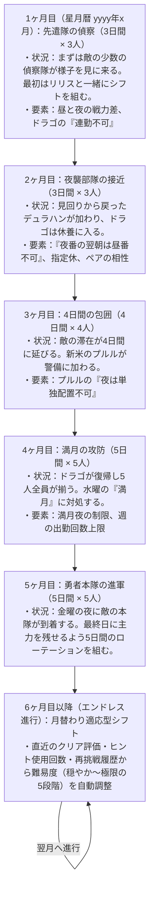
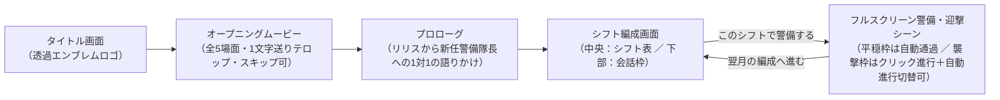

# 『魔王城の24時間警備シフト』ゲームデザイン設計書 (GDD)

## 1. ゲーム概要・トーン＆マナー指針

- **タイトル**：『魔王城の24時間警備シフト』
- **ジャンル**：拠点防衛シフトパズル
- **トーン＆マナー（文章・演出の基本方針）**：
  1. **感嘆符（！）や音符（♪）、過剰な絵文字を排する**：
     - 見出し・ボタン・セリフの末尾に「！」を連発せず、句点（。）で終わる落ち着いた自然な日本語に統一する。
     - 「神シフト」「ホワイト防衛大賞」のような大げさな煽り文句は使わず、「防衛成功」「評価 S」「お手本シフト」のように簡潔で品のある表記にする。
  2. **わざとらしい寸劇や過剰なエフェクトを入れない**：
     - 画面を激しく点滅させたり、チュートリアルでわざと失敗操作を強制するような不自然な誘導はやめる。
     - 必要な情報を静かに、分かりやすく提示し、プレイヤー自身の思考を邪魔しない。

---

## 2. 世界観・キャラクター・背景設定

### 2.1 導入（オープニングで端的に伝える状況）
- 森の奥にある「魔王城」へ、人間の勇者軍が昼夜を問わず進軍してきているという報告が入る。
- 誰かひとりに無理をさせれば、城の守りはすぐに崩れてしまう。
- それぞれの得意な時間帯と休息を守りながら、昼と夜の警備シフトを組んで魔王城を守り抜く。

### 2.2 背景設定（長文テキストではなく、1行の掛け合いと象徴表示で伝える）
- **長文の『魔王城の記録』は廃止**：
  プレイヤーが読み飛ばしてしまう長文テキスト枠は設けず、警備アニメーション中の「勇者隊と魔物の1行セリフ」および城門ライフを見守る「魔王サンショウ（オオサンショウウオ）の象徴アイコン」だけで自然に世界観を伝える。
- **魔王サンショウ（渓流の主）と人間軍（「勇者隊」）**：
  かつて人間が放置した薬品で川が汚染され、生き延びて姿を変えたオオサンショウウオが「魔王サンショウ」となった。魔物たちが森を守るために人間の街を襲うようになり、人間側も街と暮らしを守るために「勇者隊」を編成して進軍してくる。

### 2.3 登場キャラクターと性質（100倍スケール）

| キャラクター | 役職・種族 | 昼 / 夜の防衛力 | 勤務条件・連携 |
| :--- | :--- | :---: | :--- |
| **リリス** | 警備参謀 | （案内役） | シフト管理と案内を担当する参謀。 |
| **ドラゴ** | 古参門番（古竜） | 昼 **500** / 夜 **500** | **連勤不可**（働いた翌日は休み）・週3回まで。フェンリルと連携で **+100**。 |
| **カーミラ** | 夜番の主力（吸血鬼） | 昼 **200** / 夜 **400** | **夜番が得意**。プルルと同シフトで連携 **+100**、デュラハンとは不仲で **-150**。 |
| **フェンリル** | 昼番の主力（人狼） | 昼 **400** / 夜 **200** | **昼番が得意** ／ **満月の夜は出撃不可**。ドラゴ・デュラハンと連携で **+100**。 |
| **デュラハン** | 重装騎士（死霊騎士） | 昼 **300** / 夜 **400** | **夜番が得意**。フェンリル・プルルと同シフトで連携 **+100**。 |
| **プルル** | 新米警備員（スライム） | 昼 **200** / 夜 **200** | **夜の単独勤務不可**。カーミラ・デュラハンと同シフトで連携 **+100**。 |

---

## 3. 戦闘力ロール（上限付き対数正規分布）と難易度調整レバー

### 3.1 敵のランダム襲撃と戦闘力ロール（シンプル数字比べ・一撃必守ルール）
- **ランダム襲撃（`raidProbability`）**：勇者隊はすべての昼夜枠に律儀に現れるわけではなく、各月・各ティアの襲撃確率（約 40%〜55%、最低 1 枠は必ず襲撃）でランダムに進軍してくる。勇者が現れなかった平穏な時間帯はクリック不要で自動的に次の時間帯へ進む。
- **敵戦闘力の生成（上限付き対数正規分布）**：襲撃が発生した枠では、予測値（中央値 $M$）をもとにした **$\pm 2\sigma$ 上限・下限カット付き対数正規分布（Truncated Log-Normal）** から敵の実際の戦闘力 $E$ が生成される：
  $$Z \sim \mathrm{Clamp}(\mathcal{N}(0, 1), -2.0, +2.0), \quad E = \mathrm{round}\!\left(M \cdot \exp(\sigma Z)\right)$$
- **勝敗ルール**：シンプルに **`味方の防衛力 D >= 敵の実際の戦闘力 E` なら防衛成功**（同値は防衛側の勝ち）。
- **100% 安全上限（$+2\sigma$）**：敵の戦闘力は $+2\sigma$ 上限（`requiredPower`）を絶対に超えないため、適材適所やペア相性（`+100`）で **`D >= 最大上限` にすれば運負けは 0%（勝率100%）** になる。
- **一撃必守ルール（城門ライフ 1）**：襲撃頻度を絞っている分、**1度でも城門を突破されたら即敗北（`castleMaxHp = 1`、常に全襲撃の防衛成功が必須）** という緊張感あるルールになっている。

### 3.2 難易度調整レバー（どこをいじれば何が変わるか）

すべての調整パラメータは [`types.ts`](file:///Users/mitsuhisa.ota/project/washi/examples/web-demo/games/demon-castle-shift/types.ts) の `BALANCE_CONFIG` と [`stages.ts`](file:///Users/mitsuhisa.ota/project/washi/examples/web-demo/games/demon-castle-shift/stages.ts) の `ENDLESS_TIER_CONFIG` に集約されている。

| パラメータ名 | 定義場所 | デフォルト値 | 調整したときの効果（レバーの役割） |
| :--- | :--- | :---: | :--- |
| **`expectedToMaxRatio`** | `types.ts` (`BALANCE_CONFIG`) | `0.80` | 安全上限（$+2\sigma$）に対する敵予測値（中央値 $M$）の比率。**大きくする（例：`0.86`）と敵の平均戦力が上がって妥協枠が突破されやすくなり、小さくする（例：`0.74`）と妥協枠でも耐えやすくなる。** |
| **`enemyLogSigma`** | `types.ts` (`BALANCE_CONFIG`) | `0.12` | 対数正規分布の $1\sigma$ ブレ幅。**大きくすると敵の上振れ・下振れが激しくなり、小さくすると予測値通りに落ち着く。** |
| **`enemyTruncateSigma`** | `types.ts` (`BALANCE_CONFIG`) | `2.0` | 正規乱数 $Z$ のカット上限（$\pm 2.0\sigma$）。 |
| **`castleMaxHp`** | `types.ts` (`BALANCE_CONFIG`) | `1` | 城門ライフ（初期値 `1`＝一撃必守ルール）。増やすと突破許容回数が増える。 |
| **`raidProbability`** | `types.ts` / `stages.ts` | `0.42`〜`0.55` | 各時間帯に勇者隊が襲来する確率（最低 1 枠は必ず襲来）。 |
| **`ENDLESS_TIER_CONFIG`** | `stages.ts` | Tier 1〜5 | エンドレス月（6ヶ月目以降）のティア別の「日数 (`numDays`)」「要求戦力の余裕 (`slackPower`: `100`〜`0`)」「指定休の数 (`maxPtoCount`)」「満月数 (`fullMoonCount`)」「襲撃確率 (`raidProbability`)」を直接変更できる。 |

---

## 3. カレンダー進行設計（星月暦 1073年前からの月次進行 ＋ 履歴連動のエンドレス編成）

「STAGE 1」のようなメタな表記は使わず、**プレイしている日時の 1073 年前（`星月暦 yyyy年x月`）** から 1ヶ月ずつ暦が進んでいくファンタジー暦表記を採用する。基本の 5ヶ月間に加え、6ヶ月目以降は**プレイヤーの警備履歴に応じて難易度が自動調整されるエンドレス進行モード**へシームレスに続く。

---

## 4. シーン構成とクリア後の流れ

### 4.1 オープニングムービーとプロローグ（リリスからの1対1の語りかけ）
- **背景透過タイトルロゴ（[`title-logo.png`](file:///Users/mitsuhisa.ota/project/washi/public/games/demon-castle-shift/title-logo.png)）**：
  - タイトル画面およびオープニングのクライマックスでは、専用デザインの透過ロゴ画像を表示する。
- **シネマティック・オープニングムービー（全5カット・魔王の来歴は秘匿）**：
  - 「薄暮の魔王城」「進軍する人間の勇者隊」「魔王城の作戦室（城の奥深くで眠る魔王と仲間たち）」「正門に集う警備隊」「タイトルロゴ・クライマックス」の5カットを、カメラワーク（パン・ズーム）＋光粒子＋専用BGM＋字幕テロップ付きで再生する（オープニング時点では魔王の正体や来歴は伏せておく）。
- **プロローグ（リリスがプレイヤーに直接話しかける形式）**：
  - 第三者視点の背景説明（地の文）は混ぜず、全3スライドすべてを「警備参謀リリスが、新しく着任した警備隊長（プレイヤー）に1対1で話しかけるセリフ」に統一する。
  1. リリス：「あなたが新しく着任された警備隊長ですね。遠いところをよく来てくださいました。私は警備参謀のリリスです。この魔王城には、行き場を失った魔物たちが集まって静かに暮らしています。城の奥深くでは、私たちの主である魔王様も静かに眠っておられるのですよ。」
  2. リリス：「実は先日、森の外縁で魔物と人間の衝突が起きてしまいました。人間の街を守るために編成された勇者隊が、昼も夜も休まずこの砦へ進軍してきています。見回りの斥候から、敵の予測戦力が届いているところです。」
  3. リリス：「うちの門番たちは頼もしいですが、日差しが苦手なカーミラや、連勤ができない古竜のドラゴなど事情もさまざまです。どうかあなたの采配で、みんなが無理なく力を発揮できる昼夜のシフトを組んでください。一緒に私たちの魔王城を守り切りましょう。」

### 4.2 シフト成功時とステージクリア後の要素
1. **日ごとの確率バトルロールと1行カットイン**：
   - 「このシフトで警備する」を押すと、月曜の昼から順に、敵の実際の戦闘力が対数正規分布から抽選され、味方防衛力との数字比べと1行の掛け合いが表示される。
2. **仲間からの一言**：
   - 城門ライフを1以上残して1週間を守り抜くと、参加したメンバーが落ち着いた一言を返す（例：ドラゴ「中日に休めたおかげで、最後まで体が持ったぞ。」）。
3. **お手本シフトの確認**：
   - クリア後には、最も無理のない「お手本シフト」を盤面に反映して自分の組み方と見比べることができる。
4. **履歴連動のエンドレス進行（第6週以降）**：
   - STAGE 5 クリア後も第6週・第7週…と毎週のシフト編成を続けて遊べる。直近の警備履歴（評価ランク・ヒント使用回数・未達回数）に応じて、日数（3〜5日）・戦力余裕・指定休・満月夜の有無が5段階で自動調整される。

---

## 5. 画面構成とチュートリアル設計（「ゴミゴミ感」の解消）

### 5.1 画面の整理（シンプル上下2段構成）
- **右サイドバーの廃止**：
  - 画面を分割していた右カラムをなくし、**「中央のシフト表」と「下部の会話ウィンドウ」**だけに要素を絞る。
- **マスの表示を最小限にする**：
  - 1マスの中に複数のボタンやバッジを詰め込むのをやめ、**休みの日は「休」**、出撃する日だけ **「昼」「夜」** がはっきり見えるすっきりした表示にする。
  - 指定休や満月の制限があるマスは、最初から選択できない状態で静かにロック表示する。

### 5.2 下部の会話ウィンドウ（1文字ずつ表示されるメッセージ枠）
- 画面下部にキャラクターの顔アイコンと会話枠を配置する。
- セリフは落ち着いた速度で1文字ずつ表示され（クリックで即時全文表示）、状況の説明やルール違反時の理由（「ドラゴは2日続けては出られません」など）をこの枠1箇所に集約して伝える。

### 5.3 1ヶ月目のスポットライト＋吹き出しによる共同編成ガイド
- 最初の月（1ヶ月目）で「一緒に組んでみる」を選んだ場合は、**「いま操作する行・マス」以外を少し暗く（ディミング）し、対象マスのすぐ上に吹き出し（`リリスと一緒に編成 1/6` ＋ 簡潔な操作ガイド ＋ `ここからは自分で組む` ボタン）を表示**する。
- プレイヤーの視線が自然に操作対象のマスへ集まり、いつでも「ここからは自分で組む」で自由編成に切り替えられる。

---

## 6. 実装タスク

1. **Task 1: 文章・セリフ・ステージデータのトーン統一（感嘆符や過剰な装飾の排除、『魔王城の記録』全5話の追加）**
2. **Task 2: 画面構成の刷新（右サイドバー廃止、すっきりしたシフト表、下部の1文字ずつ表示される会話枠）**
3. **Task 3: プロローグ画面と STAGE 1 ガイドの実装**
4. **Task 4: 迎撃結果・クリア後の『魔王城の記録』閲覧・お手本シフト比較の実装**
5. **Task 5: テストとビルド検証**
