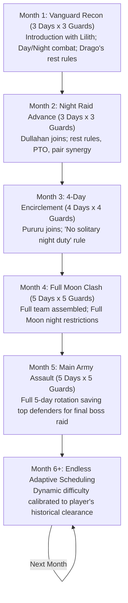
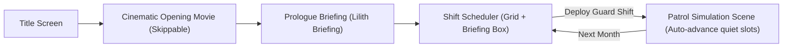

# Demon King Castle 24-Hour Guard Shift — Game Design Document (GDD)

## 1. Overview and Tone & Style Guidelines

- **Title**: Demon King Castle 24-Hour Guard Shift
- **Genre**: Base Defense Shift Scheduling Puzzle
- **Tone & Style Guidelines**:
  1. **Exclude excessive punctuation and emojis**:
     - Maintain a calm, restrained tone ending with periods rather than strings of exclamation points.
     - Avoid hyperbolic promotional phrasing; prefer clear, dignified labels such as "Defense Successful", "Rank S", and "Model Schedule".
  2. **Avoid forced theatrics or excessive flashing effects**:
     - Provide essential information clearly and unobtrusively, letting the player focus on strategic scheduling.

---

## 2. World Setting, Characters, and Narrative Context

### 2.1 Premise
- Deep within the forest, human vanguard forces approach the Demon King Castle day and night.
- If any single guard is pushed beyond their endurance, castle defenses collapse.
- Balance night/day duty preferences, mandatory rest intervals, and teammate affinities to maintain continuous perimeter protection.

### 2.2 Narrative Delivery
- Minimal narrative overhead: concise one-line battle dialogue and symbolic indicators rather than forced exposition walls.
- Guardian Lord Sansho (the giant salamander spirit) silently watches over castle gate health.

### 2.3 Cast and Unit Characteristics

| Character | Role / Race | Day / Night Defense | Constraints & Synergies |
| :--- | :--- | :---: | :--- |
| **Lilith** | Security Strategist | (Guide) | Oversees shift assignments and tactical briefings. |
| **Drago** | Veteran Gatekeeper (Elder Dragon) | Day **500** / Night **500** | **No consecutive shifts** (rest day required after work); max 3 shifts/week. Synergizes with Fenrir (**+100**). |
| **Carmilla** | Night Specialist (Vampire) | Day **200** / Night **400** | **Excels at night**. Synergizes with Pururu (**+100**); clashes with Dullahan (**-150**). |
| **Fenrir** | Day Specialist (Werewolf) | Day **400** / Night **200** | **Excels by day** / **Unavailable during Full Moon nights**. Synergizes with Drago and Dullahan (**+100**). |
| **Dullahan** | Heavy Knight (Death Knight) | Day **300** / Night **400** | **Excels at night**. Synergizes with Fenrir and Pururu (**+100**). |
| **Pururu** | Rookie Guard (Slime) | Day **200** / Night **200** | **Cannot work night shifts alone**. Synergizes with Carmilla and Dullahan (**+100**). |

---

## 3. Combat Rolls (Log-Normal Distribution) and Balance Levers

### 3.1 Random Raids and Combat Rolls
- **Random Raids (`raidProbability`)**: Human forces do not appear in every slot; they attack with a tier-based raid probability (approx. 40%–55%, guaranteed at least 1 raid). Quiet periods advance automatically.
- **Enemy Power Roll**: For active raid slots, enemy actual power $E$ is generated from a log-normal distribution around median forecast $M$:
  $$Z \sim \mathcal{N}(0, 1), \quad E = \max\!\left(50,\, \mathrm{round}_{10}\!\left(M \cdot \exp(\sigma Z)\right)\right)$$
- **Victory Condition**: Simple comparison: **Allied Defense $D \ge E$ means Defense Successful** (ties favor defender).
- **Target Defense Line (`requiredPower` $\approx +2\sigma$)**: Meeting `requiredPower` yields approximately 98%–99% defense success rate. The WaSHI solver optimizes to meet or exceed this line.
- **Sudden Death Gate Rule (`castleMaxHp = 1`)**: A single gate breach results in defeat, maintaining tactical tension.

### 3.2 Balance Levers

All balance parameters are centralized in `BALANCE_CONFIG` (`types.ts`) and `ENDLESS_TIER_CONFIG` (`stages.ts`).

| Parameter | Location | Default | Role / Effect |
| :--- | :--- | :---: | :--- |
| **`expectedToMaxRatio`** | `types.ts` (`BALANCE_CONFIG`) | `0.80` | Ratio of forecast median $M$ to required power. Higher values make compromised slots riskier. |
| **`enemyLogSigma`** | `types.ts` (`BALANCE_CONFIG`) | `0.12` | Log-normal variance ($1\sigma$). Higher values widen the enemy power spread. |
| **`enemyTruncateSigma`** | `types.ts` (`BALANCE_CONFIG`) | `2.0` | Scaling factor for minimum enemy power threshold. |
| **`castleMaxHp`** | `types.ts` (`BALANCE_CONFIG`) | `1` | Gate HP. |
| **`raidProbability`** | `types.ts` / `stages.ts` | `0.42`–`0.55` | Probability of enemy attack per shift slot. |
| **`ENDLESS_TIER_CONFIG`** | `stages.ts` | Tiers 1–5 | Configures days (`numDays`), slack power, requested PTO days, full moons, and raid probability for endless mode. |

---

## 4. Calendar Progression & Campaign Arc

Progression uses fantasy Star-Moon calendar progression (1073 years prior to current date).

---

## 5. UI Architecture & Stage Flow

### 5.1 Clean Dual-Section Layout
- **No Cluttered Sidebars**: Unified grid layout focused on the weekly shift table and dialogue brief.
- **Explicit Shift Cells**: Rest cells ("OFF"), Day duty ("DAY"), Night duty ("NIGHT").
- **Clear Restrictions**: PTO and Full Moon constraints clearly locked and explained.

### 5.2 Dialogue Briefing Window
- Displays concise context, rule feedback, and teammate remarks in a single focused dialog box.

---

## 6. Implementation Scope

1. Tone consistency and localization parity across English, Japanese, and Chinese.
2. Clean grid UI with accessible controls and mobile responsive layouts.
3. Prologue, tutorials, and guided scheduling.
4. Solver verification via WaSHI MILP solver and automated regression tests.
